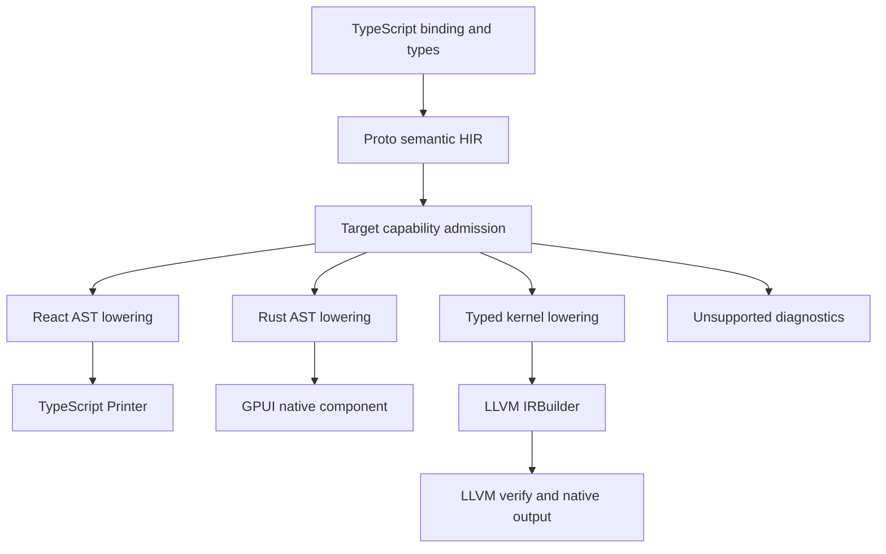

# Proto UI v2 编译方案：语义 HIR、目标降级与结构化代码生成

> 状态：Draft，`0.4 scope`，跟踪 [#1809](https://github.com/Proto-UI/Proto-UI/issues/1809)。权威实体：[D-COMPILER-ARCH-0001](../../spec/decisions/D-COMPILER-ARCH-0001.yaml)、[C-COMPILER-PIPELINE-0001](../../spec/contracts/C-COMPILER-PIPELINE-0001.yaml)、[T-COMPILER-PIPELINE-0001](../../spec/tests/T-COMPILER-PIPELINE-0001.yaml)。工程标准：[`atomic-lowering-completion.md`](./atomic-lowering-completion.md)。2026-11-25 的当前用户指令要求真正的编译管线，禁止字符串源码模板，禁止以原型运行时包装器充当编译产物。本修订替换原三层包装方案，不改变既有原型定义或自动缩减目标与消费者承诺。

## 1. 交付目标与历史边界

编译器必须从 Proto 定义及 authored 行为中建立可分析的语义表示，完成目标准入和语义降级，并生成 React、GPUI 等目标原生程序。最终组件不得重新导入原 `.proto.ts`，不得委托 `@proto.ui/runtime`、`@proto.ui/adapter-*` 或等价的原型执行器完成尚未编译的行为。达到定义要求的宿主原语可以通过普通目标库导入；它们的作用域、调用和清理必须来自编译期降级，不能承载一套通用 Proto 协议执行循环。

**当前官方Base覆盖结果为React和GPUI各0/212原型原生产出。** 本轮完整扫描了184个输入文件，识别212个原型和214个authored Hook；所有212个原型均有明确未支持结果，没有source error，也没有消费者执行声明。已通过的原生功能和目标构建测试证明相应测试输入的编译行为，不能替代这212个原型的降级工作。完整Base及消费者迁移保持required missing，不改变定义来迎合当前实现。

### 1.1 原方案的教训

旧版源码模板复制了大量通用机制，后端间重复实现语义，导致维护与产物成本扩大。`73ff2847` 的重建删除了这些实现，并采用真实 TypeScript 工具链及标量 LLVM 管线，但复杂原型仍通过 `protocol` tier 导入原定义并交给现有 adapter/runtime。它解决了部分代码重复问题，未完成这些原型的原生编译。

保留原交付说明的历史统计及其证明边界：

| 当时报告 | 实际能证明的范围 |
| --- | --- |
| 净删除约 175,348 行；源码从 214 文件缩为 23 文件 | 代码组织和规模变化，不能证明语义等价或消费者可用 |
| 184/184 Base 文件接受，212 原型、214 authored hooks | 当时抽取和包装生成路径的接受情况；包含原型运行时包装，不能算全量原生降级 |
| 5 个编译器测试文件、14 个用例通过 | 当时有限示例与工具链检查，不能替代被删除的语义回归和真实消费者验收 |
| Base Button 包装器约 23 行、1,044 字节 | 单个入口文件，未计原定义、adapter、runtime 与传递依赖 |
| React 计数器生成 `.wasm` | 独立内核生成；当时 React 组件并未调用该内核 |

这些记录不延续为本修订的通过证据。原有测试和跨目标欠项仍须逐项迁移；将失效映射登记为 `missing` 是证据债务，不能抵消债务。

IR 的价值由所表达的语义、不变量和消费方式决定。SSA 用于适合它的标量与控制流层；没有采用 SSA 本身不能证明一种 IR 无效。LLVM 验证通过也不能证明源程序语义被正确保存。

## 2. 管线和责任边界

| 层 | 责任 | 不得替代的工作 |
| --- | --- | --- |
| TS 前端 | 按真实 tsconfig 建立 Program、绑定、类型、导入和别名事实 | 不推定 TS 类型正确就满足 Proto 阶段、能力和生命周期契约 |
| Proto 语义 HIR | 表示执行顺序、表达式、控制流、状态、事件、生命周期和能力所有权 | 不把语法扫描得到的数量或位图当作完整行为 |
| 目标准入 | 检查目标是否能完整承接所需语义，为未支持项定位并报告 | 不跳过未知语句，不将未降级行为移交给原型 runtime |
| React 降级 | 将已准入语义构造成 TypeScript AST；使用目标原生状态、事件和生命周期 | 不拼接组件源码，不解析人工拼接源码来伪装 AST 生成 |
| GPUI 降级 | 构造 Rust AST、原生组件结构与 GPUI Render/事件/生命周期接线 | 不用 LLVM 内核或原生壳代替 authored UI 行为 |
| 标量内核降级 | 将可证明的纯计算及显式状态转移降低为类型化函数和基本块 | 不把元数据函数或部分规则当作完整组件 |
| LLVM 后端 | 用 LLVM C++ IRBuilder 构造 Module，验证后由标准 printer 输出 | 不拼接 `.ll`，不调用 LLVM parser 接收自造源码模板 |
| 宿主集成 | 连接原生产物、输入、状态、回调、布局、辅助功能与清理 | 不以目标文件生成替代消费者执行验收 |

React-only 编译无需为未请求的附属内核生成强制构建 LLVM。显式请求 LLVM 验证或产物时，工具链缺失必须产生失败诊断，不能返回假定已验证的结果。

## 3. TypeScript 前端

使用工作区 tsconfig 和缓存 `ts.Program` / `ts.TypeChecker` 处理模块、导出、别名、符号身份及类型。语言级事实只从同一工具链读取；Proto 专用的阶段、效果、能力和所有权分析在此基础上进行。

入口识别必须基于实际符号及声明来源。名称相同的用户函数、阴影变量、源码路径或组件导出名都不能改变语言规则。组合 Hook 和 helper 的分析依赖解析后的调用及实参绑定，不能通过 `as[A-Z]*` 命名规则证明语义。

每个分析单元保留源位置和诊断。已识别的语句必须产生 HIR 或明确证明可消除；无法解释的语句、回调、属性选项、动态访问或外部调用必须报告。不得仅因它们未出现在能力位图中而消失。

对类型断言、`any` 或不完整类型信息不能作额外语义保证。不能证明能够安全降低时，返回目标不支持；不得通过修改合法原型来迎合当前编译子集。输入不合法与合法但未支持应分别诊断。

## 4. Proto 语义 HIR

HIR 是语义层，不要求所有 UI 结构先变成低级 SSA。实现至少须为下列内容提供显式表示，或在进入后端前给出对应的未支持诊断。

| 语义               | 必须保存的事实                                                      |
| ------------------ | ------------------------------------------------------------------- |
| 符号、作用域与闭包 | 绑定身份、捕获、可变性、可见性、求值次数；不得只按文本变量名联接    |
| 表达式和控制流     | 操作数类型和顺序、短路、条件分支两侧、返回、循环及异常边界          |
| Props              | 声明、类型、默认值、empty/null/undefined 处理、受控输入、更新和订阅 |
| State              | 实例所有者、初值、读取、更新、更新后读取、通知与批处理契约          |
| 事件               | 事件类型、作用域、处理器顺序、payload、取消与传播、注册和卸载       |
| 生命周期           | 注册阶段、执行顺序、重入限制、挂载/更新/卸载和清理关联              |
| 能力与上下文       | 能力身份、owner、提供/读取/订阅、作用域、引用寿命和释放             |
| Render、规则与样式 | 元素、slot、子项、属性、动态依赖、规则优先级、命中语义              |
| 宿主操作           | 输入/焦点/可访问性/几何等目标原语的明确调用与效果                   |

能力集合与位图是 HIR 的摘要。摘要无法取代动作体、表达式或控制流；“未收集到某能力”也不能证明原程序没有该能力。

### 4.1 当前表示与覆盖边界

`ValueExprIR` 表示 literal、state/prop/local 读取、一元/二元运算和条件表达式；prop 读取区分当前值与上一次已解析值。`ActionStatementIR` 表示 state-set、局部绑定、if 的两个分支及 return；事件的 `body` 保存动作序列。`LifecycleDeclIR` 和 `PropWatchDeclIR` 保存生命周期回调及 resolved props 订阅的动作体与键集合。`LoweringGapIR` 与原型的 `unlowered` 保存操作、原因及源位置。

当前 React 执行证据已覆盖 created 首次渲染前执行、mounted/unmounted 重挂载保留状态、resolved props watch 的 hydration 跳过及 FIFO/current/previous/批量变化规则、watch 状态同步写入和 updated 的顺序。该证据限于相应回归测试；完整闭包/所有权、上下文、before-dispose、raw props 订阅及其他未支持行为仍须补充表示及降级。未具备实现时按本规范拒绝，不能仅在能力摘要出现名字就视为已实现。

### 4.2 不完整分析的处理

保留分析结果与未支持原因，方便扩大覆盖。请求某一目标的编译只有在全部相关行为具有实现时才能成功。分析出 props/state 或成功生成元数据不构成原生编译成功。

跨组件引用应解析到普通已编译目标模块。尚不能编译被引用定义时，报告依赖链；不得通过导入原定义绕开。

## 5. 目标准入与 React AST 生成

目标准入按行为及宿主能力判断，禁止组件名、导出名或路径特判。`static` / `reactive` 等可作为已编译产物的实现分类；`protocol` 不再是一个允许执行原定义的回退 tier。

React 生成器使用 `ts.factory` 构造完整语法节点，使用 `ts.Printer` 输出源码。允许构造标识符、普通字面量、类型、导入、函数、语句及表达式节点。禁止通过字符串插值、连接、`String.raw`、原始源码片段或“先拼源码再 parse”生成程序。诊断消息、输出文件名和标准 printer 产生的文本不属于源码模板。

生成器必须保存已准入语义，包括 props 默认/empty 规则、状态的实例隔离、一个事件内读写顺序、同事件多处理器的顺序、规则的命中和样式组合、生命周期清理。选择 `useState`、`useRef` 或原生 effect 是降级决策，不能因此修改定义规定的观察行为。

未实现的事件、Hook、Context、Expose、生命周期或其他行为必须产生明确的目标诊断。不得生成貌似可用但省略行为的组件。目标原生组件不得依赖原 `.proto.ts`、`createReactAdapter`、`@proto.ui/runtime` 或等价执行入口。

AST printer 成功之后还要验证生成模块可被目标工具链检查、构建和执行；源码可打印不等于组件正确。

## 6. 类型化内核与优化

适合独立降低的规则谓词、纯计算和明确状态转移可进入类型化内核表示。`i1`、`i32`、`f64`、指针等低层类型只用于该层；不得将全部 JS/Proto 值无条件转成一个动态 `Value` 容器并在运行时解释原程序。

控制流须保存所有可达分支。短路表达式须保持效果和求值次数；只有证明分支无可观察差异时才可变为无条件求值的 `select`。

结构校验覆盖值唯一性、类型、支配关系、基本块终结、PHI 前驱、函数调用签名、返回值、指针和槽访问。优化前后均验证。副作用、可能抛错/陷阱的操作和生命周期清理不得因结果未使用而随意消除。

浮点遵守 JS `number` 的适用语义：`NaN`、Infinity、±0、舍入、比较和一元负号必须保真。禁止未经条件证明的 `f64 x + 0 -> x`，不得用 `0 - x` 代替所有输入上的 `-x`。整数计算明确位宽和溢出规则；编译期折叠与目标执行须一致。优化测试比较源语义、优化前后内核及实际目标结果。

元数据导出、规则子集和状态转移内核分别记录覆盖范围。生成内核并未自动实现对应 UI 的输入、生命周期、焦点、布局或无障碍契约。

## 7. LLVM IRBuilder 后端与 ABI

### 7.1 原生 builder

后端通过 `packages/compiler/native/llvm-builder.cpp` 的原生驱动构造 LLVM Module。TypeScript 侧传递结构化请求：协议版本、类型化模块和目标 triple；该请求是编译期传输格式，最终组件不携带它运行。

驱动使用 LLVM C++ API 中的 `LLVMContext`、`Module`、`IRBuilder` 与 verifier，随后通过 `Module::print` 或 LLVM 标准产物接口输出。禁止将手写 `.ll` 交给 parser 再称作结构化生成。LLVM optimizer、assembler、代码生成器及 linker 承接各自标准工作。

对 NaN、Infinity 和负零使用显式常量编码，避免 JSON 数值序列化丢失信息。能力位图等超出 JSON number 精度的字段使用明确编码。

构建 driver 的缓存键须覆盖源码、LLVM 工具链版本和相关编译/链接参数。没有 LLVM SDK、编译器不可用、driver 构建失败、请求非法或验证失败分别返回结构化诊断。不得以空模块、占位函数或跳过验证代替所请求产物。

### 7.2 内存与调用 ABI

标量 props/state 使用版本化的 8 字节槽布局。ABI 必须公布版本、槽宽和各区域容量，声明各类型表示、字节序、目标指针宽度、对齐和 owner。字符串/枚举 ID 的有效域须明确；不能用碰巧相同的整数假定两个独立表具有相同身份。

WASM 宿主使用实例实际导出的内存，按导出的堆边界和容量分配非重叠区域，按需 grow，并在每次访问验证槽号及界限。禁止固定 `1024` / `2048` 作为适用于所有产物的布局保证；禁止在模块没有导出内存时创建与模块无关的临时内存继续运行。

多实例和多 owner 的 props/state 必须隔离。重新获取 grow 后的 buffer/view；明确内存与回调生命周期。任何未实现的字符串、聚合、闭包、外部引用或宿主 callback ABI 都是未支持项，不能靠未解析导入或默认常量掩盖。

LLVM verifier 证明 Module 满足 LLVM 结构约束；源语义保真、宿主集成和 ABI 安全另行执行验证。

## 8. 本轮 GPUI 原生后端

GPUI 与 React、LLVM 基础设施在本轮并行实施。它有独立的组件降级和真实消费验收；WASM、目标文件或元数据内核通过不能标记 GPUI 完成。

### 8.1 Rust AST 管线

GPUI 从同一 Proto 语义 HIR 进入目标能力准入，再构造 Rust 的 item、类型、表达式、语句、模式和 impl 节点。原生 Rust builder 使用 `syn` 2 的节点类型与 `prettyplease` printer；禁止通过 `quote!` / `parse_quote!` 整段模板、源码字符串连接或“先拼 Rust 再 parse”构造产物。

当前实现入口为 `packages/compiler/src/targets/gpui.ts`，结构化 driver 位于 `packages/compiler/native/rust-builder/`。它们传输编译期数据，输出普通 Rust 组件；生成程序不携带 HIR 解释器、JS 值虚拟机或 Proto 原型执行入口。

### 8.2 原生组件及宿主边界

| Proto 语义 | GPUI 降级责任 | 验收点 |
| --- | --- | --- |
| Props 与 State | 生成具名、带类型的实例字段，保存初始化、默认/empty、更新、状态约束与所有权 | 多实例隔离，props更新，状态读写与渲染一致 |
| Render 与子树 | 生成 GPUI `Render` 实现及目标原生元素树；子组件使用普通已编译模块 | 实际GPUI依赖下可构建，显示结构与定义一致 |
| 表达式、分支与事件动作 | 将动作体降为 Rust AST，保存局部绑定、if/else、return、短路和顺序；对接原生事件回调及刷新 | 一个事件内更新后读取正确，事件种类/顺序/取消语义正确 |
| Rule 与样式 | 按明确定义的目标样式映射降低谓词和效果 | 规则命中和优先级一致，未知样式不得静默无效 |
| 生命周期与资源 | 将已支持注册、订阅、更新和清理连接到GPUI宿主生命周期 | 组件销毁和重挂载不泄漏输入监听、订阅、焦点或其他资源 |
| 焦点、辅助功能与几何 | 由目标宿主原语实现物理行为，HIR保留语义意图与owner | 真实输入及辅助功能契约通过，而非只存在方法名 |

目标实现应使用实际锁定的 GPUI 依赖源码和 API。Cargo 依赖身份、版本/commit pin、feature与去重须可核对，不能为让编译通过悄悄切换现有消费者的GPUI版本。

`Context`、`Expose`、生命周期、slot、动态render或其他尚不能完整保真的能力必须报告目标诊断。不能先生成一个GPUI壳，再由用户或消费者手工重写剩余行为来满足“编译成功”。对同一能力的目标拒绝保留未来实现义务。

### 8.3 三级证据

1. **结构化生成**：生成器实际构造Rust AST；产物中没有原始Proto源码、原型runtime、通用动态Value或HIR分派器。
2. **真实目标构建与行为**：使用项目真实GPUI依赖执行Cargo检查/构建，并执行可覆盖的输入、state、props、rule及生命周期回归。仅通过Rust语法解析不算目标构建。
3. **消费者验收**：Verdant的GPUI compiler pin、生成接口、集成构建、实际输入、状态、焦点、生命周期和辅助功能路径分别验证。Shenko在本轮读取的工作区是React/Web消费者，未发现GPUI依赖，按React消费者验收；不得虚列为已存在的GPUI消费路径。结构化生成或孤立Cargo成功不能替代对应消费者的回读。

本轮消费者依赖快照（用于选择真实验证对象，不是兼容性通过结论）：

| 对象 | 已读到的状态 | 本轮验证责任 |
| --- | --- | --- |
| Verdant，HEAD `44aeee6383` | workspace GPUI来自`cyjin-yl/z3rm@e5f2f9db75e97613232b5c1946333e61fa3828ab` | 用该实际依赖检查生成组件与消费者构建/行为 |
| Verdant `compiler.pin.json` | `upstreamGPUI`记录`62e5991` | 独立核验该编译器上游基准与workspace fork的关系；不得把两针描述成同一个版本 |
| Shenko，本轮读取工作区 | React/Web消费，当前没有GPUI依赖 | 验证React产物及真实Web集成；新增GPUI消费需另有实际源码证据 |

各层单独记录passing/missing。消费者或某项能力未完成时，保留draft与required缺失证据，继续推进实现。

### 8.4 当前已执行的原生范围

当前GPUI路径已执行Rust AST生成测试，以及使用Verdant实际workspace fork `e5f2f9db75e97613232b5c1946333e61fa3828ab` 的生成组件Cargo检查与原生测试。验收夹具包括原生click产生的状态转移、bool切换、真实Render进入GPUI文本布局系统、props更新及default/empty/invalid/prevValid、实例隔离、数值边界、处理器顺序与错误中止。文本布局记录是实际GPUI元素执行证据，不是像素截图或辅助功能树验收。

该已准入范围使用明确的div/span元素树、标量props/state、已降低表达式与动作、显式映射且不重叠的样式和`host:click`。样式冲突仍待canonical cascade降级；Hook、Context、Expose、生命周期、props watch、slot/dynamic render、未映射事件/样式及无法保真的类型行为仍明确拒绝。实际代码与回执所对应的细项以test实体为准。

默认upstream GPUI pin `62e5991` 的真实生成`GpuiPinned` crate也已独立通过Cargo检查及`--locked`检查；这份证据证明该pin下的目标构建，不继承fork的原生执行结果。

上述fork测试夹具没有替换Verdant真实应用，也不覆盖Shenko的Web消费者。不能把一个依赖或孤立组件通过推导为另一依赖、应用迁移或完整能力通过。完整原型语义、真实应用集成、焦点与辅助功能仍保留各自验收义务。

可复现命令见[GPUI原生验收说明](../../packages/compiler/native/rust-builder/test-support/README.md)；原始运行输出分别保存为[fork构建与6项原生测试](../../packages/compiler/native/rust-builder/test-support/evidence/verdant-fork.txt.gz)、[upstream独立构建](../../packages/compiler/native/rust-builder/test-support/evidence/upstream-pinned.txt.gz)和[driver冷缓存重建](../../packages/compiler/native/rust-builder/test-support/evidence/cache-rebuild.txt.gz)。

## 9. 诊断、统计与命令行

API 和 CLI 共享结构化诊断：错误码、类别、严重度、源位置、目标、未支持能力及其依赖原因。错误定位应回到原始 Proto 源码或具体生成阶段。显式请求的产物失败时返回失败；多个目标应分别报告结果，不能以一个目标的通过覆盖另一个目标失败。

统计至少区分：

| 结果                 | 计数边界                                                            |
| -------------------- | ------------------------------------------------------------------- |
| `analyzed`           | 建立了分析结果；可能仍含未支持项                                    |
| `compiled-native`    | 所选目标全部相关行为已降级，生成可构建目标程序，无原型 runtime 回退 |
| `unsupported`        | 合法行为尚无完整降级；保留能力和位置诊断                            |
| `invalid`            | 输入或中间表示不符合适用定义                                        |
| `kernel-emitted`     | 生成了明确覆盖范围的内核；不等于组件完成                            |
| `consumer-exercised` | 真实消费者已执行定义对应的输入、状态、生命周期等路径                |

当前编排API选择`target: react | gpui | kernel | ir`。`ir`是分析/中间表示输出，`kernel`是显式内核目标，二者不得计入UI组件完成。`inventoryProject`使用实际结果`emitted`、`unsupported`、`source-error`、`hook-analysis`，并单独报告`executionVerifiedPrototypes`：

- `emitted`说明对应目标产物已生成，尚不能单凭该状态认定已通过目标构建或行为验收。
- `unsupported`保留准入/降级诊断；`source-error`保留输入错误；`hook-analysis`只记录Hook分析，不虚增组件数量。
- 未运行目标行为验证时`executionVerifiedPrototypes`为`0`，不能由生成成功推导成通过。

上表的`compiled-native`和`consumer-exercised`是需要构建/执行证据的验收分类，不是把`emitted`改名。同一文件可含多个导出；文件数、原型数和 hook 数分别报告。

`info` 报工具链及目标能力；`check` 不得将未支持的目标记为通过；`ir` 展示所请求的中间表示及未支持原因；`llvm` 与 `compile --wasm` 必须实际完成所请求的 LLVM 阶段；`compile` 仅在产物成功后发布输出。所有失败都保留诊断并使用确定退出码，不覆盖已有输出掩盖失败。

## 10. 验收与测试映射

以下是验收义务，当前证据以 `T-COMPILER-PIPELINE-0001` 的实现映射与本次提交的执行回执为准。

本轮[官方Base双目标统计](../../packages/compiler/evidence/ast-pipeline-20261125/base-inventory-summary.json)如下。两次统计均分析184个输入文件、识别212个原型及214个authored Hook；每个目标为179个unsupported文件及5个hook-analysis文件。

| 目标  | 原型声明 | Native emitted | Unsupported原型 | Source error文件 | Execution verified |
| ----- | -------- | -------------- | --------------- | ---------------- | ------------------ |
| React | 212      | 0              | 212             | 0                | 0                  |
| GPUI  | 212      | 0              | 212             | 0                | 0                  |

按doesworkstation日志日期2026-11-25，本轮最终编译器集成执行了12个Vitest文件、61项测试，全部通过且无跳过；包含前端HIR 15项、CLI 5项、内核准入2项、Base统计1项、React AST 10项及源码编译4项、SSA 3项及LLVM builder 8项、WASM ABI 3项及LLVM pipeline 3项、GPUI AST 5项、native assets 2项。另有Verdant fork下6项原生Rust测试，以及fork工作区与默认upstream pin的独立Cargo检查。

strict TypeScript检查已覆盖compiler全部src/test与build-pinned、pinned-cli-entry脚本，可通过compiler的`check:types`脚本复现。另行执行的仓库`check:types:workspace`也已在当前工作树及干净`73ff2847`基线分别以0错误通过；此前隔离环境的依赖和ignored生成文件缺失已补齐，没有通过业务源码改写或类型忽略消除错误。Base统计测试验证未支持项及零执行声明的诚实报告；它不证明整个Base语料已原生编译。完整应用迁移仍为required missing。

集成执行保留[Vitest原始日志](../../packages/compiler/evidence/ast-pipeline-20261125/vitest.log)、[退出回执](../../packages/compiler/evidence/ast-pipeline-20261125/vitest-exit.json)和[汇总回执](../../packages/compiler/evidence/ast-pipeline-20261125/receipt.json)。临时固定包的移位/冷缓存消费是另一份[机制验证](../../packages/compiler/evidence/pinned-package-snapshot-01a33b38/README.md)，不等于最终candidate pin验收。

| 层 | 必须执行的检查 |
| --- | --- |
| 绑定与前端 | 导入别名、re-export、阴影变量、组合与 helper、未知语句定位、分支与效果保存 |
| HIR/内核 | 控制流及类型不变量、优化差分、±0/NaN/Infinity、短路、状态读写顺序和所有权 |
| React AST | 静态输出、props 更新/default/empty、多个 state/handler、规则、已支持生命周期、卸载；生成代码无原型/runtime回退 |
| LLVM builder | 真实 C++ driver 构建、结构化请求、LLVM验证、实际WASM/原生产物、数值差分与失败诊断 |
| GPUI AST与宿主 | Rust AST结构化构造、真实GPUI依赖的Cargo构建、props/state/events/rules/lifecycle，尚未支持能力明确诊断 |
| ABI | 槽界限、容量、实际内存、grow、多个实例、缺失元数据/内存的明确失败 |
| 全量语料 | 每个导出的 analyzed/compiled-native/unsupported/invalid 结果与原因，不要求错误地全绿 |
| 真实消费者 | 原有 GPUI、Shenko、Verdant 及其他承诺场景的真实编译、构建、运行与回归 |

对已编译组件计最终传递依赖和宿主支持成本；分别记录冷、热与增量编译耗时，不能把已有 Program 的单文件扫描与全量冷编译直接比较。行数和字符串模板关键词检查可作为辅助检查，不能替代 AST 构造证据与行为测试。

扩大原生覆盖是交付工作。明确拒绝未知语义可以修复静默误编译，但拒绝本身不能勾掉该语义原先的实现承诺。

## 11. 目标与消费者迁移债务

本轮同步建立前端、语义层、React AST、GPUI Rust AST及LLVM IRBuilder后端。React和GPUI逐项实现目标能力；两者与LLVM标量内核分别验收。GPUI已进入本轮实施，真实组件和消费者仍须取得各自证据。以下责任不会因本次删除或重命名自动消失：

- 全量 Base 及各设计家族的原生编译覆盖与语义回归。
- Vue、Vue 2、Web Components、SSR、GPUI/Rust、Qt、Flutter 等已记录目标的状态与原有承诺核对；实现、未实现和明确经决策退出须分别记录。
- Shenko的React/Web消费，以及Verdant的GPUI消费：分别核对compiler pin、产物接口、构建、输入、状态、生命周期和辅助功能；Verdant workspace与compiler.pin上游GPUI两针独立验证。
- 文档站/浏览器编译、CLI、库/链接及现有产物迁移路径。
- 旧测试及 spec 中失效证据的替代、正式验收和发布要求。

未完成目标保持明确状态，不借 `private: true`、`0.4 scope` 或包扫描配置宣告完成或取消。对应定义仍为 draft；任何稳定承诺的晋升需要真实实现和适用验收。

## 12. 工具链参考

- [TypeScript Compiler API](https://github.com/microsoft/TypeScript/wiki/Using-the-Compiler-API)：Program、绑定与类型查询。
- [LLVM Programmer’s Manual](https://llvm.org/docs/ProgrammersManual.html)：LLVM 类型、Module 与 IR 构造 API。
- [LLVM Language Reference](https://llvm.org/docs/LangRef.html)：指令、属性、数据布局与 well-formedness；不替代 Proto 源语义。
