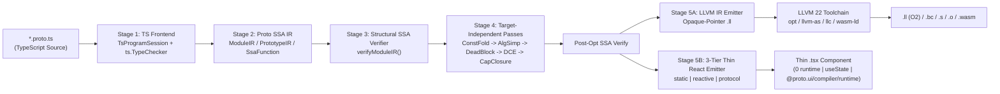

# Proto UI v2 编译器架构与编译方案规范（0.4 Scope）

> **状态**：Draft（`0.4 scope`，跟踪 Issue [#1809](https://github.com/Proto-UI/Proto-UI/issues/1809)）  
> **关联权威实体**：`D-COMPILER-ARCH-0001`、`C-COMPILER-PIPELINE-0001`、`T-COMPILER-PIPELINE-0001`  
> **关联工程标准**：[`atomic-lowering-completion.md`](./atomic-lowering-completion.md)  
> **包边界**：`packages/compiler`（`private: true`，`protoUi.release.scan: false`）；不替代或晋升任何 `0.3` 稳定发布承诺。

---

## 1. 背景、问题诊断与架构红线

### 1.1 旧版 v1 编译器失败根因复盘（#1809）

在清理重做前的 `origin/main`（`8fac6eeb0`）基线上，`packages/compiler` 累计膨胀至 **663 个文件 / 180,744 行代码**（其中 `src/` 214 文件 / 90,572 行，`test/` 447 文件 / 90,172 行），却存在系统性架构失效：

1. **字符串模板拷贝运行时（`String.raw` 伪编译）**：将数千行手写 DOM 模块、状态机与胶水代码以 `String.raw` 硬编码在 emitter 内部，每编译一个组件便整块复制。结果是一个 4 行空组件生成 1,060 行（53.3 KB）React 或 9,855 行（728 KB）GPUI；178 行 `base/button` 生成 5,459 行（251.5 KB / 10 文件）React；且 4 个 Web 后端重复维护 4 份高度冗余的模板。
2. **重复造轮子的前端**：在已依赖 `typescript` 的前提下，仍手写 ~30,000 行自制语法/类型/表达式分析器与 2,800 行平行 IR 校验器，导致真实的 `dialog`、`popover`、`select`、`hover-card`、`tooltip`、`slider` 等官方 Base 原型编译直接失败。
3. **虚假的中间表示与运行时解释器**：IR 未采用规范 SSA 形式，未接入成熟编译器优化/后端基础设施；GPUI 后端甚至内嵌迷你 JS 解释器，违背「编译期消除、目标原生表示」原则。
4. **失控的交付复杂度**：为在浏览器文档页运行旧版编译器，强行引入 QuickJS-in-WASM 沙箱、自研文件链接器与多套历史迁移脚本，同时堆积未真正可用的 Flutter / Qt / SSR 幽灵文件。

### 1.2 v2 架构不可违背的六条红线

1. **零 `String.raw` 嵌入式运行时**：`packages/compiler/src/**` 中禁止将运行时模块以大段源码模板复制到生成产物。共享运行时逻辑归位到可 Tree-Shake 的 `@proto.ui/compiler/runtime`（复用规范的 `@proto.ui/adapter-react` 与 `@proto.ui/runtime`）。
2. **真实 TypeScript 编译器前端**：基于工作区真实 `tsconfig.json` 的缓存 `ts.Program` + `ts.TypeChecker` 完成符号解析、别名追踪与类型读取；禁止正则匹配或文件名启发式猜测。
3. **正规类型化 Proto SSA IR**：具备显式基本块、单赋值 SSA 寄存器、严格结构校验器（`verifyModuleIR`）以及目标无关优化 Pass。
4. **真实 LLVM IR 与工具链集成**：直接发射合法的 Opaque-Pointer LLVM IR（`.ll`），并接入真实 LLVM 22 工具链（`opt`、`llvm-as`、`llc`、`wasm-ld`）执行验证、`O2` 优化、bitcode/原生汇编/目标文件生成以及可执行 `wasm32` 内核编译。
5. **能力驱动的三层渐进降级（0 组件名分发）**：输出层级完全由编译期计算出的 64-bit 能力闭包与模板/动作形态决定，严禁按组件名、导出名或文件路径特判业务逻辑。
6. **诚实可证的证据边界**：所有性能、体积、LLVM 验证与真机执行数据均由自动化测试直接产生；未安装 LLVM 或未实现的后端必须显式降级/拒绝，严禁伪造通过。

---

## 2. 总体编译管线架构



### 2.1 目录与职责边界

| 目录 / 模块 | 职责 | 禁止越界项 |
| --- | --- | --- |
| `packages/compiler/src/frontend/` | `TsProgramSession` 缓存管理、符号/别名解析、Prototype/Hook/Rule/Template/Helper 抽取与初始 SSA 构造 | 禁止内嵌目标框架代码或手写平行类型系统 |
| `packages/compiler/src/ir/` | `PROTO_IR_VERSION = 2` 类型定义、64-bit 能力位图、`SsaBuilder`、结构校验器、SSA 优化 Pass、`.pir` 文本打印器 | 禁止耦合 React/DOM/Web/Rust 特定细节 |
| `packages/compiler/src/llvm/` | Proto SSA IR -> Opaque-Pointer LLVM IR (`.ll`) 发射器、LLVM 工具链探测与子进程封装（`opt`/`llvm-as`/`llc`/`wasm-ld`） | 禁止静默吞掉 `opt -passes=verify` 错误 |
| `packages/compiler/src/targets/` | 面向具体目标的薄型代码生成器（当前为 3-Tier React emitter；后续扩展 Vue 3 / WC / Native） | 禁止 `String.raw` 拷贝运行时；禁止按组件名分支 |
| `packages/compiler/src/runtime/` | 导出 `@proto.ui/compiler/runtime`：`createCompiledReactComponent` 薄桥接层、`PrototypeProps<T>` 类型辅助、`instantiateWasmKernel` 8-byte Slot ABI 宿主封装 | 禁止重实现 Proto UI Kernel 或重复维护 DOM 模块 |
| `packages/compiler/src/browser/` | 面向文档站的最小协议类型兼容边界（已移除 QuickJS-in-WASM） | 禁止引入浏览器内嵌 JS VM |
| `packages/compiler/src/compiler.ts`, `cli.ts` | 编译编排器（`createCompiler`/`compileFile`/`compilePrototype`/`compileProject`）与 CLI（`info`/`check`/`ir`/`llvm`/`compile`） | 禁止隐式覆盖已存在输出或隐藏诊断 |

---

## 3. Stage 1：TypeScript 前端与语义抽取规范

### 3.1 `TsProgramSession` 会话与缓存模型

- 读取工作区根目录（或显式传入）的 `tsconfig.json`，合并安全默认项（`noEmit: true`、`skipLibCheck: true`）。
- 同一编译器实例内部复用 `SourceFile` 缓存与增量 `ts.Program`：
  - 批量编译（`compileProject(files)`）通过 `session.ensureFiles(files)` 一次性构建 `ts.Program`，所有文件共享同一个 `ts.TypeChecker`。
  - 内存/虚拟源码编译（`compilePrototype(source, { fileName, files })`）通过 `createVirtualProgram` 叠加虚拟文件映射并复用基础库/工作区类型，编译完成后清理虚拟映射以避免污染会话。
  - 文件变更时支持 `invalidateFile(path)` 精确失效。

### 3.2 符号与组合解析规则

1. **原型与 Hook 入口识别**：沿 `checker.getExportsOfModule(moduleSym)` 与 `checker.getAliasedSymbol` 追踪导出的 `definePrototype(...)`、`defineAsHook(...)`、`defineHook(...)` 调用，支持 `export default`、具名导出、变量中转与跨模块 re-export。
2. **字面量与常量求值**：优先提取 AST 标量字面量，并回退到 `checker.getTypeAtLocation(expr)` 的字符串/数字/布尔字面量类型，从而正确解析 `const KEY = 'disabled'` 等类型级常量。
3. **组合闭包追踪（Authored Hooks & Local Helpers）**：
   - 遇到内置 Hook（如 `asTrigger`、`asFocusable`、`asAccessible`、`asOverlay`、`asPositioning`、`asAnatomy` 等 21 个标准原子 Hook），记录为 `kind: 'builtin'`。
   - 遇到 `as[A-Z]*` 形态的 authored hook（如 `asButton`、`asDialogRoot`），在 `ts.Program` 中定位其 `defineAsHook` / `defineHook` 定义并递归扫描其 `setup` 体（带 `visitedFns` 环路保护），将间接声明的 props、states、hooks、rules、context、lifecycle 纳入原型闭包。
   - 遇到将 `def` 作为参数传入的本地辅助函数（如 `setupShadcnStyleSelection(def, ...)`），递归追踪形参对应的 `def.*` 操作。
4. **运行时回调能力扫描（`run.*`）**：对 `def.lifecycle.*`、`def.event.on*`、`def.props.watch*`、`def.context.subscribe*` 传入的回调体扫描首个 `run` 形参的 `run.context.*` 访问（例如 `run.context.tryReadAncestor(KEY)`），防止仅在运行时回调使用的能力被漏判。
5. **纯标量 Helper 降级**：模块顶层声明的纯标量 TypeScript 函数（参数与返回值均为 `number` / `boolean`，函数体由算术、比较、逻辑、三元条件、`if/return`、局部变量绑定构成）会被直接降级为导出的 SSA 函数 `helper_<name>`，随原型一起进入 LLVM 优化与 WASM/原生编译。

### 3.3 64-Bit 能力位图规范（`CAPABILITY_BITS`）

编译期为每个原型计算确定性的 `bigint` 能力位图 `capabilityMask` 及规范名称列表 `capabilities`，既用于分层判定，也直接以 `define i64 @<protoSym>_capabilities()` 导出到 LLVM IR 与 `<Name>Meta`：

| Bit | 名称 | 触发来源 |
| --- | --- | --- |
| `0` | `props` | `def.props.define` 声明至少一个 prop |
| `1` | `state` | `def.state.*` 声明至少一个 state |
| `2` | `expose` | `def.expose.*` 声明至少一个对外暴露项 |
| `3` | `event` | `def.event.on` / `def.event.onGlobal` |
| `4` | `lifecycle` | `def.lifecycle.{onCreated,onMounted,onUpdated,onUnmounted,onBeforeDispose}` |
| `5` | `context` | `def.context.*` 或回调内 `run.context.*` |
| `6` | `style` | `def.feedback.style.use(tw(...))` 或含静态样式 token 的 `def.rule` |
| `7` | `rule` | `def.rule(...)` |
| `8` | `render` | 所有原型均包含渲染输出（`default-slot` / `static-tree` / `reactive-tree` / `dynamic`） |
| `9..25` | `trigger`, `focus`, `accessible`, `controlLabel`, `anatomy`, `collection`, `overlay`, `boundary`, `hitParticipation`, `positioning`, `scroll`, `textControl`, `imageView`, `tableStructure`, `nativeLink`, `axisInput`, `presence` | 对应内置原子 Hook 调用 |
| `26` | `shader` | shader 表现能力保留位 |
| `27` | `authoredHooks` | 调用任何 `kind: 'authored'` 组合 Hook |

---

## 4. Stage 2 & 3：Proto SSA IR 规格与结构校验器

### 4.1 顶层 IR 结构（`PROTO_IR_VERSION = 2`）

```text
ModuleIR
 ├─ irVersion: 2
 ├─ sourceFile: string
 ├─ prototypes: PrototypeIR[]
 │   ├─ identity: name, exportName, isDefaultExport, span
 │   ├─ tier: 'static' | 'reactive' | 'protocol'
 │   ├─ capabilities: CapabilityName[], capabilityMask: bigint
 │   ├─ declarations: props[], states[], exposes[], events[], hooks[], contexts[], lifecycle[]
 │   ├─ presentation: staticStyleTokens[], rules[], render (RenderIR)
 │   ├─ stringTable: string[] (驻留字符串/枚举 ID 表)
 │   └─ functions: SsaFunction[] (规则谓词、规则位图求值器、事件状态转移内核)
 ├─ authoredHooks: AuthoredHookSummary[]
 └─ functions: SsaFunction[] (模块顶层降级的纯标量 Helper)
```

### 4.2 SSA 类型系统与指令集

SSA 类型与 LLVM 标量/指针类型 **1-to-1 对应**：

| SSA 类型 | 语义                                          | LLVM IR 类型 |
| -------- | --------------------------------------------- | ------------ |
| `void`   | 无返回值                                      | `void`       |
| `i1`     | 1-bit 布尔值                                  | `i1`         |
| `i32`    | 32-bit 整数 / 驻留字符串或枚举 ID / 规则位图  | `i32`        |
| `f64`    | IEEE-754 双精度浮点数（JS `number`）          | `double`     |
| `ptr`    | 不透明指针（`%props` / `%states` 槽数组基址） | `ptr`        |

支持的核心指令（`SsaInst`）与终结指令（`SsaTerminator`）：

- **纯值指令**：
  - `const <type> <value>`：常量物化。
  - `load_prop <type> <propsPtr>[slot]`：从只读 props 槽加载标量。
  - `load_state <type> <statesPtr>[slot]`：从 states 槽加载标量。
  - `binop <add|sub|mul|div|rem|and|or|xor> <type> <lhs>, <rhs>`：同类型二元算术/逻辑运算。
  - `cmp <eq|ne|lt|le|gt|ge> <operandType> <lhs>, <rhs> -> i1`：标量比较。
  - `not <operand> -> i1`：布尔取反。
  - `select <type> <cond:i1>, <trueVal>, <falseVal>`：无分支条件选择。
- **调用与副作用指令**：
  - `store_state <statesPtr>[slot] = <value:type>`：向 states 槽写回更新值。
  - `call <callee>(<args...>) -> <returnType>`：模块内 SSA 函数调用。
  - `host_op <emit_event|request_update|set_present|apply_style_rule>(<args...>)`：显式宿主副作用钩子。
- **基本块终结指令（每块恰好 1 条）**：
  - `br <targetLabel>`
  - `condbr <cond:i1>, <trueLabel>, <falseLabel>`
  - `ret [value]`

### 4.3 结构校验器不变量（`verifySsaFunction` / `verifyModuleIR`）

任何 IR 在进入优化前与优化后都必须满足以下不变量；违背任一条均产生 `PUI_IR0xx` 错误并阻断后端代码生成：

1. `irVersion` 必须严格等于 `PROTO_IR_VERSION`（`2`）。
2. 函数至少包含 1 个基本块；所有基本块标签在函数内唯一。
3. 严格 SSA 单赋值：函数参数与所有指令结果 `%id` 不得重复定义。
4. 终结指令的跳转目标标签必须存在于当前函数的基本块集合中。
5. 所有操作数引用必须已在当前作用域/参数中定义，且满足静态类型规则：
   - `condbr.cond`、`select.cond`、`not.operand` 必须为 `i1`；
   - `binop` 与 `cmp` 左右操作数类型必须与指令声明类型一致；
   - `select` 两个分支值类型必须与 `select.type` 一致；
   - `ret` 存在返回值当且仅当函数 `returnType !== 'void'`，且类型精确匹配；
   - `load_prop` / `load_state` / `store_state` 的基址必须为 `ptr`，且 `slot >= 0`。

---

## 5. Stage 4：目标无关 SSA 优化 Pass 规范

`optimizeModuleIR` 对所有原型函数和模块辅助函数执行有界不动点迭代（最多 8 轮，任一轮无变更即提前收敛）：

1. **Constant Folding（常量折叠）**：
   - 对全常量操作数的 `binop`、`cmp`、`not`、`select` 直接在编译期求值并替换为 `const`。
   - 对 `condbr` 条件为已知常量的终结指令直接折叠为无条件 `br`。
2. **Algebraic Simplification（代数化简）**：
   - `f64` / `i32`：`x + 0 -> x`、`x - 0 -> x`、`x * 1 -> x`、`x / 1 -> x`（注意保持 IEEE-754 边界，不对可能产生 `-0` 或 `NaN` 的危险情形激进消除）；
   - `i1`：`x && true -> x`、`x && false -> false`、`x || false -> x`、`x || true -> true`、`!!x -> x`。
3. **Dead Basic Block Pruning（不可达基本块裁剪）**：
   - 从入口块（`blocks[0]`）执行 BFS，仅保留可达基本块，消除因常量分支折叠产生的死路径。
4. **Backward Liveness DCE（反向活跃性死代码消除）**：
   - 将终结指令与副作用指令（`store_state`、`call`、`host_op`）作为根集合，沿 def-use 链反向标记所有活跃 SSA 值，删除全部未被引用的纯指令。
5. **Capability Closure Pass**：
   - 依据最终抽取和降级结果重新收敛 `capabilities` 与 `capabilityMask`。

每次优化完成后必须通过 `verifyModuleIR` 二次校验，保证 Pass 本身不会破坏 SSA 结构合法性。

---

## 6. Stage 5A：LLVM 22 IR 降级、8-Byte Slot ABI 与原生工具链

### 6.1 LLVM IR 生成规则（`src/llvm/emit.ts`）

发射目标采用 **LLVM 22 原生 Opaque-Pointer（`ptr`）语法**，具备完整头部元信息（`source_filename`、`target datalayout`、`target triple`）：

- **双精度常量编码**：除有限简单十进制外，对浮点字面量使用 LLVM IEEE-754 64-bit 十六进制编码（`0x...`），杜绝十进制文本往返带来的精度漂移或 `-0.0` 丢失。
- **函数属性标注**：对无副作用的纯函数（规则谓词、规则位图求值器、能力位图函数、纯标量 helper）标注 `nounwind`（及适用时的 `willreturn`），帮助 LLVM `opt -O2` 进行激进内联与常量传播。
- **标准导出符号约定**：
  - `@<protoSym>_capabilities() -> i64`：返回原型 64-bit 能力位图常量。
  - `@<protoSym>_rule_<id>(ptr %props, ptr %states) -> i1`：单条声明式规则的纯谓词求值。
  - `@<protoSym>_eval_rules(ptr %props, ptr %states) -> i32`：合并前 31 条规则返回命中位图（供宿主一次 FFI/WASM 调用批量计算样式条件）。
  - `@<protoSym>_on_<event>_<idx>(ptr %states) -> void`：纯事件状态转移内核（如 `count + 1`、`!flag`、`set literal`）。
  - `@helper_<name>(...)`：顶层纯标量 TS 辅助函数。

### 6.2 Uniform 8-Byte Aligned Slot ABI

为保证 JS/TS 宿主、WebAssembly 线性内存与未来原生 C/Rust FFI 之间共享同一个极简且零对齐陷阱的内存布局，`%props` 与 `%states` 缓冲区采用 **统一 8 字节对齐槽数组（Uniform 8-Byte Slot Array）**：

| Slot 索引 | 字节偏移 | `i1` (bool) 布局 | `i32` (string/enum ID) 布局 | `f64` (number) 布局 |
| --- | --- | --- | --- | --- |
| `0` | `+0` | offset `+0` 存 `i8` (`0` / `1`)，`trunc`/`zext` <-> `i1` | offset `+0` 存小端 `i32` | offset `+0` 存 IEEE-754 小端 `f64` |
| `1` | `+8` | offset `+8` 存 `i8` | offset `+8` 存小端 `i32` | offset `+8` 存小端 `f64` |
| `k` | `+8 * k` | `getelementptr inbounds i8, ptr %base, i64 (8*k)` | 同左 | 同左 |

WASM 宿主封装（`@proto.ui/compiler/runtime` 中的 `instantiateWasmKernel`）：

- 默认约定线性内存区间：`propsBase = 1024`，`statesBase = 2048`（避开零地址和栈区），支持自定义偏移；
- 通过 `DataView` 提供类型安全的 `setPropBool/F64/I32`、`setStateBool/F64/I32`、`getStateBool/F64/I32` 与直接导出函数调用。

### 6.3 真实 LLVM 22 工具链流水线（`src/llvm/toolchain.ts`）

| 能力函数 | 底层 LLVM 命令 | 产出物 | 失败语义 |
| --- | --- | --- | --- |
| `detectLlvmToolchain()` | `opt --version` + 路径探测 `opt`/`llc`/`llvm-as`/`wasm-ld` | 工具链可用性与精确版本号 | 无 LLVM 时返回 `{ available: false }`，绝不伪造成功 |
| `verifyLlvmIr(ir)` | `opt -passes=verify -disable-output` | 验证通过/失败 | 语法或类型错误返回 `PUI_LLVM002` + 完整 stderr |
| `optimizeLlvmIr(ir, level)` | `opt -passes=verify,default<O2> -S` | 优化后的 `.ll` | 失败返回 `PUI_LLVM003` |
| `assembleLlvmBitcode(ir)` | `llvm-as` | 二进制 LLVM bitcode (`.bc`) | 失败返回 `PUI_LLVM004` |
| `compileLlvmToAssembly(ir, triple)` | `llc -mtriple=<triple> -filetype=asm` | 目标汇编 (`.s`) | 失败返回 `PUI_LLVM005` |
| `compileLlvmToObject(ir, triple)` | `llc -mtriple=<triple> -filetype=obj` | 原生目标文件 (`.o`) | 失败返回 `PUI_LLVM005` |
| `compileLlvmToWasm(ir)` | `opt -passes=verify,default<O2>` -> `llc -mtriple=wasm32-unknown-unknown -filetype=obj` -> `wasm-ld --no-entry --export-all --allow-undefined --initial-memory=65536` | 可直接交给 `WebAssembly.instantiate` 执行的 `.wasm` 字节码 | 缺 `wasm-ld` 或链接错误返回 `PUI_LLVM006` |

---

## 7. Stage 5B：三层渐进式降级与 React 代码生成规范

### 7.1 分层判定函数（纯能力闭包驱动）

```text
hasProtocolFeatures :=
    hooks.length > 0
 || exposes.length > 0
 || contexts.length > 0
 || lifecycle.length > 0
 || rules.length > 0
 || render.kind === 'dynamic'

if (!hasProtocolFeatures && states.length === 0 && events.length === 0)
    tier = 'static'          // Tier 0
else if (!hasProtocolFeatures
         && (render.kind === 'static-tree' || render.kind === 'reactive-tree')
         && events.every(e => e.scope === 'root' && e.simpleAction !== undefined))
    tier = 'reactive'        // Tier 1
else
    tier = 'protocol'        // Tier 2
```

### 7.2 各层输出契约

1. **Tier 0（`static`）**：
   - 生成纯 React 函数组件（约 14 LOC），仅 `import * as React from 'react'`。
   - 静态元素树与静态 `tw(...)` 类名直接编译为原生 `React.createElement(...)` 与 `className` 合并，**零 Proto UI 运行时导入**。
2. **Tier 1（`reactive`）**：
   - 生成原生 React Hooks 组件（约 15–30 LOC），仅 `import * as React from 'react'`。
   - 每个 `def.state.*` 直接降级为 `React.useState(initialValue)`；
   - 每个 `simpleAction` 事件直接降级为原生 React 事件 prop（`onClick` 等）调用 `setState((v) => ...)`；
   - **零 Proto UI 运行时或 kernel 导入**；同时 LLVM 管道独立产出该组件的状态转移 `.wasm` 内核以供验证或跨宿主复用。
3. **Tier 2（`protocol`）**：
   - 生成紧凑且强类型的 React 包装器（~20–25 LOC，**零 `any`**）：
     - 导入 `createCompiledReactComponent` 与 `PrototypeProps`（来自 `@proto.ui/compiler/runtime`）；
     - 以可移植相对路径（磁盘输出）或包路径导入原 `.proto.ts` 定义；
     - 导出冻结的 `<Name>Meta: CompiledComponentMeta`（含 `tier`、`capabilities`、`capabilityMask`、`props`、`states`、`exposes`、`staticStyleTokens`）；
     - 导出 `create<Name>(options?)` 与默认组件 `<Name>`。
   - 完整运行时语义（Focus、Accessibility、Overlay、Positioning、Anatomy、Context、Lifecycle、Rule 动态订阅）全部由规范的 `@proto.ui/adapter-react` + `@proto.ui/runtime` 统一承接，彻底消灭 N 份重复复制的 DOM 补丁代码。

---

## 8. 诊断规范、CLI 契约与验证矩阵

### 8.1 统一诊断结构

每条诊断均为不可变结构化对象：

```ts
interface CompilerDiagnostic {
  readonly code: string; // PUI_FE0xx | TSxxxx | PUI_IR0xx | PUI_LLVM0xx | PUI_EMIT0xx
  readonly severity: 'error' | 'warning' | 'info';
  readonly category: 'input' | 'typecheck' | 'frontend' | 'ir' | 'llvm' | 'emit';
  readonly message: string;
  readonly span?: {
    file: string;
    line: number;
    column: number;
    endLine?: number;
    endColumn?: number;
  };
}
```

### 8.2 CLI 命令契约

入口：`packages/compiler/src/cli-entry.ts`（逻辑位于 `src/cli.ts`）

- `info`：输出 `PROTO_IR_VERSION`、已探测 LLVM 工具链版本与工具路径（JSON）。
- `check <file> [--types] [--verify-llvm]`：执行前端抽取、SSA 校验与优化，可选开启 TS 类型检查与 LLVM `opt -passes=verify`。
- `ir <file>`：打印优化后的 `.pir` 文本表示。
- `llvm <file> [--optimize]`：打印验证通过的 LLVM IR（`.ll`），`--optimize` 输出经 `opt -passes=verify,default<O2>` 优化后的 `.ll`。
- `compile <file> --out <dir> [--ll] [--pir] [--wasm]`：写出薄型 React `.tsx` 组件及可选的 `.ll` / `.pir` / `.wasm` 产物。

### 8.3 四层可执行验证矩阵（对应 `T-COMPILER-PIPELINE-0001`）

| 层次 | 测试文件 | 验证内容 |
| --- | --- | --- |
| SSA IR 与优化 | `packages/compiler/test/ssa-ir.test.ts` | 64-bit 能力编码、常量折叠、代数化简、死块裁剪、反向活跃性 DCE、非法 SSA 拒绝（`PUI_IR0xx`）、`.pir` 打印 |
| LLVM 22 与 WASM 真机执行 | `packages/compiler/test/llvm-pipeline.test.ts` | 真实 `opt -passes=verify`、`opt -O2`、`llvm-as` `.bc`、`llc` 原生 `.s`/`.o`、`wasm32` `.wasm` 链接并在 `WebAssembly.instantiate` 中通过 8-byte Slot ABI 实测规则位图/状态转移/纯 helper 执行；以及非法 LLVM IR 拒绝（`PUI_LLVM002`） |
| 3-Tier React 实测执行 | `packages/compiler/test/react-codegen.test.ts` | React 19 + `happy-dom` 真实挂载与交互验证 Tier 0 (`static`)、Tier 1 (`reactive` 计数器点击递增)、Tier 2 (`base/button`, `base/toggle`, `base/switch`)；静态断言 `packages/compiler/src/**` 零 `String.raw` |
| 官方全量语料与 CLI | `packages/compiler/test/base-corpus.test.ts`, `packages/compiler/test/cli.test.ts` | 184/184 `packages/prototypes/base/src/**/*.proto.ts`（212 原型 + 214 authored hooks）100% 编译通过、平均 < 20 LOC / 热编译 < 50 ms/file、复杂家族抽样通过 LLVM 22 `opt -passes=verify`；Shadcn Button 含规则编译验证；CLI 全子命令端到端测试 |

---

## 9. 0.4 后续演进路线（Steps 4+）

本规范当前完成 **Steps 1–3**（清理重建、TS 前端 + Proto SSA IR + LLVM 22/WASM 管线、3-Tier 薄型 React 后端与全量 Base 语料验证）。后续在 `0.4 scope` 下沿同一 IR 骨架继续渐进演进：

1. **更广的 SSA 降级与 Tier-1 覆盖**：将带条件分支、只读对象/数组访问、多规则样式计算与受控 props 计算下沉为纯 SSA 函数与原生 React/Vue 响应式代码，进一步缩小需要回退到 Tier 2 的集合，同时严格遵守 [`atomic-lowering-completion.md`](./atomic-lowering-completion.md) 的语义保真边界（NaN、`-0`、UTF-16 长度、单次求值）。
2. **多 Web 目标薄型后端**：基于同一 `ModuleIR` 与能力闭包实现薄型 Vue 3（Composition API）与 Web Component 后端，共享相同 3-tier 判定而不复制运行时。
3. **原生宿主（GPUI / Rust）LLVM 直连**：通过 LLVM IR -> 目标 `.o` / `.a` 静态库或薄型 FFI 绑定直接复用意图/规则/状态转移内核，彻底替代旧版 10k 行 Rust 嵌入式 JS VM。
4. **文档站按需编译体验**：若 `0.4` 需要恢复文档站浏览器编译体验，应基于轻量级标准 Worker 方案重构，不再重新引入 QuickJS-in-WASM。
