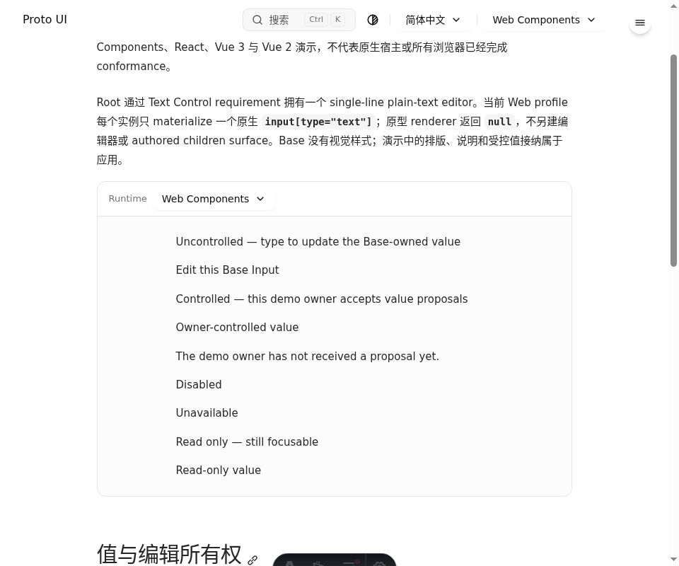
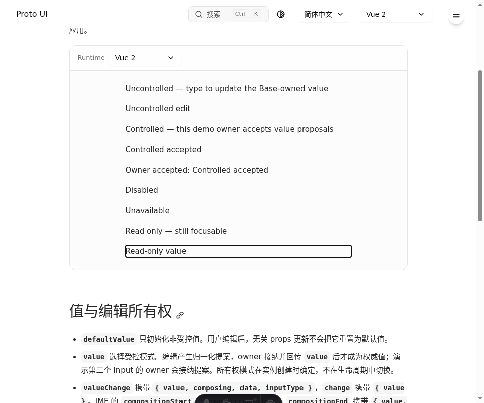

# Input 精确版本证据：恢复结果与待执行验收

本记录服务于 [#1155](https://github.com/Proto-UI/Proto-UI/issues/1155)，基线为 `0607c6c5c386b8a932ab850e92a8873b2121dc45`。当前用户授权的范围是恢复 Input 原始版本证据，并补齐现有浏览器入口的双语、相邻状态和源码绑定；Main 负责实际验证、发布、评审和集成。本次没有运行产品检查、构建、格式化或浏览器，没有上传、提交、修改 GitHub 或关闭 Issue。

完整原始条件、固定 source key、各版本源码 SHA-256、20 份保留图片及其 lineage 在 [JSON 记录](2026-11-10-input-exact-version-evidence.json)。原 frozen ledger、corrections 和历史 evidence 未被改写。

## 原始条件与所有权

| Source key / parent key | 完整原条件 | 本次状态 |
| --- | --- | --- |
| `issue.1155.001` / `issue.1093.001` | 接取有界新 Issue 并记录授权 — 历史状态 pending | live Issue 已勾选，保留 2026-11-07 audit 的历史说明；本次不重新声称验证其全部旧 PR。 |
| `issue.1155.002` / `issue.1093.002` | 实现新 Issue 并提交对应 PR — 历史状态 pending | live Issue 已勾选；本次候选尚未提交 PR。 |
| `issue.1155.003` / `issue.1093.003` | 持续响应评审直到获准合并闭环 — 历史状态 pending | live Issue 已勾选；本次候选仍须 Main 验证、独立评审、修复与合法集成。 |
| `issue.1155.004` / `issue.1093.004` | 关闭 Input 精确版本视觉证据欠账 — 历史状态 pending | 证据恢复与 capture 源码已准备；没有取得新 native、visual 或 publication 通过结果，保持未完成。 |
| `issue.1155.005` / `issue.1093.005` | 定位 Textarea 运行时就绪验证超时 — 历史状态 pending | 完整保留，链接 #1164 / Main 的现有 owner，不写第二套 Textarea/readiness 实现。 |

`issue.1093.010` → `issue.1157.004` 另保留完整条件：“Input 必须补齐实际最终 head 的 visual/publication 证据，不能用 materially different 旧 head 的截图关闭债务”。#1157 负责其历史 source ledger，#1155 负责这里的 Input evidence candidate，二者互链，不重复当前 capture 实现。

Main 预留三个现有 Input browser suite 和新 helper；#1160 owner `SolMore1160Forms` 已确认排除这些路径。#1095 InputShell 保持独立。没有修改共享 harness、planner、全局文档注册、Prototype、Compiler/IR 或 Textarea。全量 live #1155 discussion 已按实际计数读取：一页 11/11 comments。

## 版本与真正恢复的内容

| 版本 | 可证明的内容 | 仍不能证明 |
| --- | --- | --- |
| PR #812 qualified `2ea0499f555a32e927493e0d04e44d3b56e0c945` | 恢复 16 份原始 PNG、原始 Chinese native-journey 与 stable-recapture receipts；其中 10 份 PNG 与历史 Read blob 的 SHA 完全一致。 | 最终 `2dd4` 或当前 head 的运行；全量 EN/ZH、主题、family、built-output、所有 overlay、AT 或 OS IME 验收。 |
| PR #812 final `2dd4b96c8fdd783b5e0e5df79fc263ca411237b5` | 固定 Git 对象源码、shared preview/shell/renderer/CSS 的版本差异；2026-11-10 真实认证读取 run `37364391539` 为 completed/failure，artifact inventory `total_count: 0`。 | 原归档内容、final rendered pixels、built-output/overlay 接受。不能用 `2ea` 或今天的截图替代。 |
| PR #885 observed `1699b70ecf5ff51459aebb3f7bedeed92f9f111b` | 从唯一原会话的四个实际 Read 事件恢复 WC/React/Vue/Vue2 WebP readbacks；保留 `owner-conversation:885:6094851533`。 | 原 PNG bytes/hash：原路径已不存在。WebP 是历史 Read 表示，不能改称原 PNG、final #885 或今天的运行。 |
| PR #885 final `63fc86e5105038d194eb2b5ac1a59c3f717bd5f5` | 固定版本源码 SHA，与 observed version 分列。 | final native/production 部署或 publication 接受。 |
| 当前候选 | 37 个相关 source path 的基线字节、原始版本 preimages、三个现有 suite 的有界增量。 | 任何新检查结果、原生截图、上传 URL、CI/DCO、独立接受或 Issue closure。 |

原始 #812 图保存在 [2ea0499f 目录](../../docs/evidence/input-exact-version/2ea0499f/)。保留了不合格的滚动/裁切尝试，没有以较晚的 stable capture 删除旧失败。特别是 React CDP 图片仍裁掉 preview 顶部，不能据其声称完整 framing 接受。Chinese receipt 中的 Vue2 isolated/main-realm 观察是工具 realm 差异，不是另一套 Playwright 失败的已证实根因。





#885 的四份历史 Read 表示在 [1699b70 目录](../../docs/evidence/input-exact-version/1699b70/)。本地保留不等于已上传；发布必须由 Main 检查图片内容、说明、实际可读 URL 和源版本后完成。

## 已准备的消费路径

继续使用现有三个 browser suite，不增加第二套 Input browser inventory。Base 已有 EN/ZH；Shadcn、Brutalist 补齐两个 locale。每个 family 是 2 locale × 4 runtime，共 **24 个计划 native case**。新 metadata suite 有 **3 个计划 case**：相同 HEAD 下源码字节变化、隐藏的新 authored source、缺失 tracked source。全部尚未执行。

| Family | 公共路由 | 每个 locale/runtime 的相邻 capture | 计划 PNG 数 |
| --- | --- | --- | --- |
| Base | `/{en,zh-cn}/ui-libraries/base/input/` | light initial → uncontrolled edit → owner acceptance → readonly → dark readonly → runtime replacement/reset | 48 |
| Shadcn | `/{en,zh-cn}/ui-libraries/shadcn/input/` | light initial → selection → pointer focus → dark focus → selection → keyboard edit → readonly/disabled protection | 56 |
| Brutalist | `/{en,zh-cn}/ui-libraries/brutalist/components/input/` | light initial → edit → readonly → focus → dark focus → composition transport → 320px/100% → 320px/200% dark → light | 72 |

完整成功时共 176 PNG；这是计划输出，不是执行计数。Shadcn 的 selection 由 DOM focus/setSelectionRange 建立，记录明确标注；Brutalist 的 composition 仍是原 synthetic transport probe，不是 OS IME 证据。两项均未换成新的产品行为或 native 输入宣称。

新 `input-visual-evidence.ts` 把截图与 source manifest、Git HEAD/tree、dirty 状态、浏览器/Node 版本、viewport、route、locale/runtime/theme/state、CSS 与截图哈希绑定。它包含 hidden 与 untracked authored source，保留 literal symlink。结束时 source/CSS/image drift 会拒绝该批证据；旧输出目录不能覆盖上一份 `source.json`。dirty 源码和外部未验证 server 不获得 `commitBound`。`session.json` 明确要求另有完整 Vitest（包括 hooks/teardown）结果、视觉检查与上传回读；JSON 不能自行证明测试通过。

所有相关 Input/TextControl Prototype、Contract、Module、Host Capability 方向仍为 **draft**；四个 active Web Adapter profile 的 module/capability relation 不自动激活它们。保留 Shadcn base-nova 与 Brutalist pinned upstream 的已记录 parity gaps，没有改 spec、产品协议或旧 hash。

## Main 的串行执行命令

先在 Main 的专用 heavy slot 准备依赖完整的 checkout。下列命令均为 **未执行的 Main handoff**。使用 Node 24；每个证据根目录必须全新。`before` 必须是 Main 单独准备、HEAD 精确为 `0607c6c5c386b8a932ab850e92a8873b2121dc45` 的干净 checkout，不能在已修改的候选树里假称基线。

```sh
export PATH=/home/ezra/.npm/_npx/387698761821791d/node_modules/node/bin:$PATH
mkdir /tmp/i1155-before-01
```

在该精确 baseline checkout 中执行原三套，预计收集 Base 8、Shadcn 4、Brutalist 4，共 16 native case。原 Base/Shadcn 临时截图路径由实际 stdout 取得，不能把“产生临时图片”改称有源码绑定或已上传：

```sh
env -u PROTO_UI_BROWSER_BASE_URL -u PROTO_UI_NEO_INPUT_EVIDENCE_DIR PROTO_UI_RUNTIME_EVIDENCE_DIR=/tmp/i1155-before-01 corepack pnpm@10.32.1 exec vitest run apps/www/src/content/docs/zh-cn/demo-base-input.browser.test.ts apps/www/src/content/docs/zh-cn/demo-shadcn-input.browser.test.ts apps/www/src/content/docs/zh-cn/demo-brutalist-input.browser.test.ts --maxWorkers=1 --no-file-parallelism --reporter=default --reporter=json --outputFile=/tmp/i1155-before-01/vitest.json
```

在本 Issue worktree 先由 Main 执行所需格式化并重绑定候选 hashes，再执行 metadata consumer。三个 metadata case 只证明 source identity 边界，不能充作 native 或 failed-before 产品证据：

```sh
corepack pnpm@10.32.1 exec prettier --write apps/www/src/content/docs/zh-cn/demo-base-input.browser.test.ts apps/www/src/content/docs/zh-cn/demo-shadcn-input.browser.test.ts apps/www/src/content/docs/zh-cn/demo-brutalist-input.browser.test.ts apps/www/src/content/docs/zh-cn/input-visual-evidence.ts apps/www/src/content/docs/zh-cn/input-visual-evidence.test.ts internal/records/2026-11-10-input-exact-version-evidence.json internal/records/2026-11-10-input-exact-version-evidence.md
corepack pnpm@10.32.1 exec vitest run apps/www/src/content/docs/zh-cn/input-visual-evidence.test.ts --maxWorkers=1 --no-file-parallelism
mkdir /tmp/i1155-after-01
env -u PROTO_UI_BROWSER_BASE_URL -u PROTO_UI_NEO_INPUT_EVIDENCE_DIR PROTO_UI_RUNTIME_EVIDENCE_DIR=/tmp/i1155-after-01 corepack pnpm@10.32.1 exec vitest run apps/www/src/content/docs/zh-cn/demo-base-input.browser.test.ts apps/www/src/content/docs/zh-cn/demo-shadcn-input.browser.test.ts apps/www/src/content/docs/zh-cn/demo-brutalist-input.browser.test.ts --maxWorkers=1 --no-file-parallelism --reporter=default --reporter=json --outputFile=/tmp/i1155-after-01/vitest.json
```

读取 `/tmp/i1155-after-01/{base-input,shadcn-input,neo-input}/{source,session}.json`、每张 PNG/sidecar 和实际 runner JSON，核实恰好 3 suite/24 case，区分 failed/skipped/not-run，查看 source/CSS/image 是否保持一致。保留 before/after 所有失败。Main 的集成批次还须执行适用 types、既有 runtime planner/guard 和 Agent 文档检查；不因为这份记录先声称其通过。

```sh
corepack pnpm@10.32.1 check:types
node --test scripts/test/run-runtime-tests.test.mjs
corepack pnpm@10.32.1 check:agent-doc
```

原 final `2dd4` 必须另在该精确原始源码 checkout 执行 built evidence，driver/source 两份 provenance 分开。Main 先用原 lock/dependency scope 构建，预览固定端口，再从另一进程运行那个原始 checkout 中的 Base Input 8-case suite：

```sh
corepack pnpm@10.32.1 --filter apps-www build
corepack pnpm@10.32.1 --filter apps-www exec astro preview --host 127.0.0.1 --port 4175
```

```sh
PROTO_UI_BROWSER_BASE_URL=http://127.0.0.1:4175 corepack pnpm@10.32.1 exec vitest run apps/www/src/content/docs/zh-cn/demo-base-input.browser.test.ts --maxWorkers=1 --no-file-parallelism
```

这三条历史回放命令尚未执行，也未取得该旧 checkout 的 dependency/native readiness。必须绑定真实 `2dd4` 源码、构建输出、实际服务进程、runner、完整临时 PNG 和视觉结果；不得移植今天的 helper 后仍把 source 标成 untouched `2dd4`。旧 suite 的通过也不覆盖全部共享 Dialog/Select/Tooltip/Dropdown consumer；原独立 built-output/affected-overlay 债保持单独核对。

## 视觉、发布与关闭前的剩余条件

Main 应逐个 runtime/locale 检查真实 preview framing、相邻编辑/owner/只读/重挂载状态、focus ring 是否被裁切、CJK 字形、light/dark 可读性，以及 Brutalist 320px/200% 的实际控件尺寸。比较 Base、Shadcn 与 Brutalist 各自的权威，不从一种 family 外推另一种。source manifest、非空 boxShadow 和截图数量不能代替可见结果判断。

先完成适用 native/visual 验证和 review repair，再在当前授权目的地发布足够的 exact-source 图，读回实际可访问 URL 和 commit/head；保留历史图片自身的 caption。没有图片上传或托管 CI/DCO 结果时仍记录 debt。PR 合入、图片恢复和 current-main 新截图均不能自动关闭原 `2dd4` 验收。

Textarea 的 exact-head Node24 CI、Windows native 启动/子进程清理、真实 Chrome、150s 全 `beforeAll` 预算，以及两个本地入口 wrong-app/去 await/错误 cwd 的负控继续由 #1164 / Main 跟进。保留先前 Node22 测量、startup15/readiness128、后来 stop-owner13 的日期与范围，以及共享 readiness/harness pin 的原边界。每个适用原条件真正完成后才记 bounded completion；#1155 整体仍 open。
