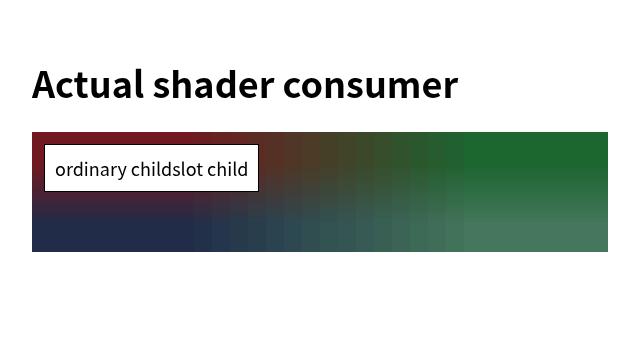
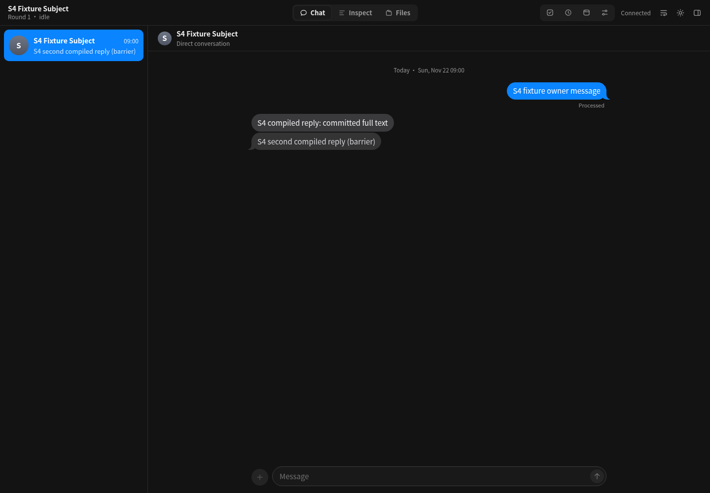

# Sprint 4 integration and actual consumer evidence

Delivery: [PR #1714](https://github.com/Proto-UI/Proto-UI/pull/1714), based on `dc3b184ba10b0de53e40359c52d012b204b2cd01`. The current user requested Sprint 4 implementation through PR readiness and identified [Shenko](https://github.com/cyjin-yl/shenko) as a real Harness application and [Verdant](https://github.com/OpenGreendam/verdant) as another real consumer. This record tracks the public compiler changes and their actual downstream checks. It does not certify the separate private IR10 candidate or close an umbrella issue.

## Preserved scope

| Issue | Public contribution in this PR | Preserved acceptance boundary |
| --- | --- | --- |
| #1143 | Presentation presence through native Web targets; a draft owned-pixels shader contract, Runtime/Feedback/Adapter implementation and native compilation with explicit resource ownership | Other Presentation source families, application backing-source leases, additional shader kernels and non-Web GPU realization require their own evidence. No draft lifecycle is promoted. |
| #1089 | One unchanged authored Transition source against a definition-derived oracle in DOM-free Runtime and four native Web outputs; shader and actual application consumers use their real source paths | A lexical source audit is not universal semantic purity proof. Each changed shared definition and host realization retains its own evidence; physical GPU and native assistive technology are not inferred from Web tests. |
| #892 | Deferred unused local callable admission, real reached-body checking and unchanged-source provenance | The original imported-unused-Prototype case already worked in public IR7. Its preserved replay is separate from the old IR10 compiler's acceptance. |
| #893 | Real readonly getter IR, read-time effects and native execution, including the original 270-byte source; parameterless Web Component renderer repair | Original rest TS2322 remains invalid. Unsupported getter targets diagnose explicitly. |
| #894 | Actual optional callable module selection, inert import cycles, initialization order and retained `answer = 42` effects | The original three-file graph is replayed through current public IR7; it does not certify the original compiler closure. |
| #891 | Complete original rest graph remains red; a separately named explicit-annotation control is strict-TS lawful and has identical helper JavaScript/runtime values | Ordinary helper execution is distinct from whole-Prototype and generated-native execution. Both complete graphs retain the current computed-binding-key refusal. |
| #913 | Original archive, complete source/object inventory and actual dependency DAG recovered and verified | Original authors' rights/DCO, real public dependency layers and independent original-candidate acceptance remain outstanding. |
| #914 | Complete original definition-reference inventory, current revision comparison and owner decision packet | An inventory is not the governing owners' acceptance of the exact definitions. |
| #915 | Original producer/validator/consumer migration scope recovered; current applications are concrete downstream inputs | Current IR7 candidate rechecks are not an executed IR5-to-private-IR10 migration. |

The [original recovery ledger](./2026-11-22-sprint4-ir10-recovery.md), [public semantic repair record](./2026-11-22-sprint4-public-compiler-semantics.md) and [getter record](./2026-11-22-sprint4-record-getters.md) retain their actual source and execution boundaries. Earlier checkpoint hashes and failed observations remain historical; subsequent success does not relabel them as final-head runs.

## Independent composition

`independent-transition-owner.proto.ts` consumes the existing `asTransition` implementation without modifying it. The same complete source graph is used by a real `RuntimeSession` in a Node environment without DOM globals and by ordinary generated React, Vue3, Vue2 and Web Component consumers. The oracle comes from `C-AS-TRANSITION-0001`, `C-TRANSITION-COLD-PREPARATION-0001` and `P-BASE-TRANSITION`.

The three journeys cover retired cold-preparation releases across reopen, synchronous observer reentry that interrupts an enter, and terminal disposal of callbacks/state. All **15 combinations passed**. The native check keeps the zero-owner-timer assertion. Vue's separate process-wide devtools discovery timer is prevented with an inert devtools sink, rather than counted as a component resource or hidden by changing the assertion. An earlier failed fixture used a raw Runtime exposure port; the actual scoped public reader supplies the contract's callback execution scope.

The shader tests use a separate CPU color oracle, the same authored declaration for Runtime and generated consumers, and real WebGL2 allocations, image decode and resource deletion observations. Fake host controls used by the independent reviewer test ownership ordering only and are not counted as GPU execution. The local process sandbox prevented Chromium socket creation before any of the first 16 browser tests ran. The supported connected test device subsequently passed a Chromium sandbox/WebGL2 environment preflight using Chromium 145.0.7632.6 and ANGLE SwiftShader; this is a software GPU, not a physical GPU performance result. Candidate browser execution is recorded separately below when complete.

## Independent review repairs

An implementation-independent reviewer retained the original reproductions before requesting these changes:

| Finding | Owning repair and discriminating evidence |
| --- | --- |
| S4-R1: foreign array prototypes bypassed shader data admission | All dense-array inputs check their prototype. Separate pixels, passes, tint and fallback controls reject foreign prototypes. |
| S4-R2: old shader work could overwrite an external paint owner | Ownership loss persists for the old lease/view. Late decode and a new revision of the same view cannot reacquire the replaced paint channel; cleanup preserves the external writer. |
| S4-R3: resolving an alias to a hoisted function erased an intermediate TDZ | Check every admitted eager alias/data initializer in dependency and statement order, including ordinary data fields of getter objects. Package exports remain link-ready; default factory exports retain their real initialized snapshot. |
| S4-R4: copy-only generated consumers carried unneeded tint support | Native shader support is selected from the reached kernel closure. Emitted host and exact kernel identities are checked independently, including strict generated-consumer types. Runtime retains its general device provider. |
| S4-R5: unselected callable branches skipped signature obligations | Both branches use the same declaration/signature checks as other dormant callables before previewing their legal type. Rest/generator/duplicate/default-TDZ controls reject; unselected body/default captures remain inert. |
| S4-R6: different reached shader kernels conflicted in a multi-entry project | Verify every entry's host, ownership and kernel manifest against its canonical emitted bytes before taking the project-wide reached-kernel union. Four target profiles exercise mixed copy/tint entries; altered or missing support remains an error. |
| S4-R7: restoring a previous shader capability reused its retired view identity | Each actual Feedback-to-sink binding gets a monotonic generation. Restoring A after A-to-B replacement can paint again without admitting old frames or old releases; remount preserves monotonicity. |
| S4-R8: installing an unused shader capability changed ordinary Effects retry timing | The synchronous shader publication path now requires an actual shader declaration. A failed ordinary host publication retains its existing deferred retry, with or without the unused capability. An independent disposer-based control also distinguishes the original failure from the repaired path; genuinely declared shader publication remains immediate. |

The R3/R5 integration lane passed **161/161 tests in seven files**, including the pre-existing source-graph, module data/storage, callable-selection and dormant tests. Its initial 123/124 result exposed a mapped default-factory-export regression in the first repair; that case was repaired without weakening the existing assertion. The reviewer independently replayed the two original TDZ and four signature inputs and observed their intended diagnostics. Final review remains bound to the frozen published source and validation packet.

## Actual application candidates

| Application | Preserved application revision | Original compiler pin | Candidate procedure |
| --- | --- | --- | --- |
| Shenko | `f3fa6f4d8bf22cfd2baf490d9c3a08bd39af4d42` | `f29738eb6a804ccfc58510cc5a5bd1692690716e` | Separate application worktree; explicit candidate commit/lockfile pin; original compiler producer, public package dependency build, typecheck, application tests and production bundle. Browser smoke uses the actual frontend with isolated API fixtures. |
| Verdant | `91a775546ebd21a87d76d76568195a6513437719` | `e56b2d1a3d6b688a1cbc6930dab1d6757304d733` | Separate application worktree; explicit candidate compiler pin; original producer emits verbatim GPUI Rust; actual `EditorSession` generated gesture tests consume that crate. |

Verdant's original-pin baseline passed all **7** `generated_gestures` application tests with Rust/Cargo 1.98.1 and its unchanged workspace GPUI dependency `e5f2f9db75e97613232b5c1946333e61fa3828ab`. This establishes the environment and baseline only. The candidate producer and rerun remain separately required. The isolated Node/native toolchains and development libraries were installed in task-owned directories; no system policy or browser sandbox was weakened.

These worktrees validate the proposed upstream compiler. They do not publish an application upgrade, connect to a live Harness backend, or claim the applications already adopted this PR.

## Executed consumer and integration evidence

The evidence index is [Sprint 4 observations](./evidence/2026-11-22-sprint4/observations.json). It preserves each actual source revision and the SHA-256 of its original receipt. The parent implementation `c857471f7897fad58479d0b5a976fc88fc1e26fd` and test-only correction `ef60557fbd2c486ca15885c3e38d92f599f140a3` have identical production implementation bytes. R8 is a subsequent bounded Feedback repair; earlier observations retain their original revision.

| Source and scope | Actual result | Boundary |
| --- | --- | --- |
| `ef60557`, Chromium 145.0.7632.6, sandbox enabled, ANGLE SwiftShader | Shader **20/20** and Presence **16/16**. Four hosts × Runtime/compiled; actual GPU readback against a separate linear-color oracle, fallback failures, context loss, stale decode, capability replacement and cleanup. Presence covers displayed-frame reversal and reduced motion. | Software WebGL2, not physical-GPU performance. The first `c857471` run's nine observer failures remain preserved. The fixes select the actual live GPU context and compare DOMRect width at subpixel precision, retaining the five-second cleanup bound and all motion assertions. |
| `ef60557`, complete workspace types after the required style generator | **Passed**, plus canonical shader generation and public manifest checks. | The first direct type invocation's test typing errors and missing ignored style output remain recorded. |
| Original optional callable graph on `ef60557` | Complete three-file parse/cold validation and **4/4** ordinary generated native consumers preserve `answer = 42`, render and disposal. | The native component executions use the DOM model. They do not claim four physical browser executions or private IR10 acceptance. |
| Original dormant and rest inputs on `ef60557` | The one frozen named dormant test passes (**42 others unselected**). The full original rest graph retains TS2322; the separately named legal annotation control has zero strict-TS diagnostics and identical emitted helper JavaScript and values. | Whole-Prototype computed binding keys remain explicitly unsupported in both complete rest graphs. |
| Original 270-byte getter source on `c857471` | Parser/cold validation and **4/4** ordinary generated native consumers pass. | Original source SHA-256 is `afc674007d860620722bcae793d6a982723767db478499a7ec47563bdca65b3a`; compiler implementation is unchanged by the later test and Feedback-only corrections. |
| Shenko original producer on `c857471` | 42 public dependency packages, original typecheck, **51/51** original application tests, production bundle and producer provenance verification pass. | Application source is unchanged except the explicit temporary pin and generated artifacts. |
| Shenko actual production frontend built above | **6/6** browser stages: initial status/bubble, streamed slot update with identity, tail update, committed state and ignored late duplicate, reconnect label/style, and cleanup. | HTTP/WS fixtures are isolated; no live service, user session or backend writes. Cleanup delivers a synthetic PageTransitionEvent through the real production handler before navigation. This is not the whole S7 Harness acceptance. |
| Verdant migrated temporary consumer on `ef60557` | Original **7/7** EditorSession gesture tests and complete `cargo check --offline --locked -p verdant-app` pass. Fresh GPUI/data producers and `--check` pass; independent replay preserves all 25 retained artifact hashes. | Actual original source and test bytes are unchanged. Consumer bindings require the explicit migration described below; no native window, OS input, assistive technology or audio result is inferred. |

Verdant's initial unchanged-consumer upgrade failed first on its old generated crate package name and then on its obsolete static `call_data_method` API. The instance-owned API change already existed in base history at `2403772bea490de3cc9e79f009ab25e2fe7d6962`. The reviewed migration retains the generated GPUI view, and routes the three headless decisions through the existing `C-COMPILER-RUST-DATA-0001` / `rust-data-v1` contract: `planNoteGesture`, `planControlGesture` and `dragNormalized`. The canonical producer writes the dependency-free Rust data artifact; no fake mounted owner or handwritten generated reducer is used. The [complete temporary consumer patch](./evidence/2026-11-22-sprint4/verdant-consumer-migration.patch) applies cleanly to the original application revision. It has not been published to the application repository.

The retained source-bound visuals were inspected directly:

`ef60557`, React compiled, 640 × 360, default light fixture: the authored owned-pixel shader paints the surface while both native children remain above it. JSON resource/readback observations, rather than this still image, establish lifecycle and color correctness.

Shenko `f3fa6f4d8bf22cfd2baf490d9c3a08bd39af4d42`, compiler `c857471`, 1440 × 1000, dark fixture: the actual production entry renders the compiled message bubbles and connection status. All displayed conversation data belongs to the isolated test fixture.

## Full-cycle and package boundaries

The actual full CI [45017591649](https://github.com/Proto-UI/Proto-UI/actions/runs/45017591649) targets `ef60557`. Its whole-entry package comparison fails five existing ceilings; this red report is retained, not converted to an advisory result. Exact baseline CI [45017955280](https://github.com/Proto-UI/Proto-UI/actions/runs/45017955280) targets `dc3b184`. Any numerical change is a separate measured transaction with its own final canonical result.

The full cycle also observed the original Scroll Area WC drag result `scrollTop === 0` after the 1000 ms bound and the Homepage family query missing its original 1000 ms bound. The latter's preserved writer/query timeline distinguishes a real write within the bound from a late query result. Those observations remain failed until their own controlled diagnosis/replay establishes a disposition. Unchanged files alone do not prove an inherited failure. R8 does not explain the Scroll Area preview, which already uses a visual sink. Experimental Liquid results remain their own source-bound acceptance work. The complete run inventory and terminal conclusions are read back in the PR; a focused pass or skipped PR lane is not a complete-cycle pass.

`.github/workflows/package-budget-evidence.yml` provides a manual/callable complete-package build and strict measurement using the same Node 24, pnpm 10.32.1, manifest checks and measurement controls as `ci.yml`. It adds no automatic trigger, changes no existing regression lane or measurement policy, and always preserves the actual source-bound report. Final exact-head PR readiness and independent review are recorded on the PR after validation and readback; this record alone does not declare a green full cycle or a GitHub approval.

Agent provenance: ChatGPT coding agents authored the new public implementation, tests and records under the current user's instruction. A separate fresh context reviewed the implementation and supplied the seven falsifying probes. No GitHub self-approval, original-author certification, merge, release or application deployment is claimed.
