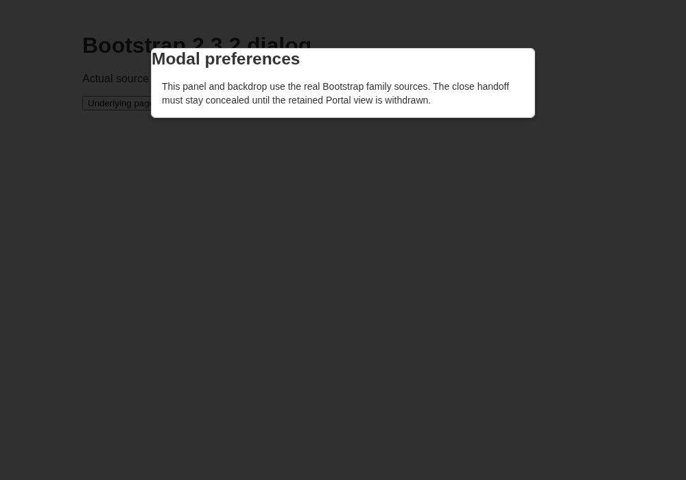

# Sprint 6 current-main union and retained-present reentry checkpoint

This is a bounded, partial development checkpoint before preserving a newer external Sprint 6 branch. It does not merge PR #1712, promote a draft contract, or claim full native acceptance.

## Source and preserved history

- Existing local HEAD: `366a38112bd0ba994f2ef6a7743ffc981a051bfe`.
- Normal pending merge parents: `84ef7893e732a316388aeb730af1758b96f703e8` and `0fbb52ef832cc27c78e24c28c59a55a16f51d7fe`.
- Prepared source tree before this evidence-only addition: `8882ea51f4ce4ce99f37dbdc5df75d5975efa3fc`.
- The current main's distinct `HC-CONTROL-LABEL-0001-GPUI` and `HC-CONTROL-LABEL-0001-GPUI-PROVIDER` IDs are retained. The historical single-ID conjunction is not reapplied.

The sixteen designated historical originals remain byte-for-byte restored from concurrent commit `24e553961e7a898b74b959792d35f49364f35efc` after main integration. The earlier 93-artifact record is unchanged. External Dialog/Focus/Vue2 lifetime work, composition journeys, held-image reuse and main CLI/token changes retain their own historical evidence attribution.

An earlier publication wrapper stopped after 900 seconds while its Git child was pending. Later direct readback proved normal signed-off commit `366a38112bd0ba994f2ef6a7743ffc981a051bfe` completed with tree `e2683714e4aae455bd05e73073975dfd14f88197`, both expected parents and a clean worktree. The pending wrapper and the later actual completion are distinct preserved receipts; no duplicate commit or force push resolved that uncertainty.

## Retained-present reentry repair

The current marker-first close sequence exposes synchronous attribute reentry before concealment starts. The unchanged public-Props fixture initially failed at its immediate detached-marker assertion. A complete fixed-helper baseline executed 73 tests: 72 passed, and that same marker assertion failed. The fourteen CLI cases passed in that actual current-main run.

`C-HOST-VIEW-ATTACHMENT-0001` remains draft. Its criterion B binds the detached marker to not-present intent. The narrow repair lets a newer present intent clear the marker when the same owner already retains a view, including reentry before concealment starts. Main's marker → version/owner guard → conceal → guard order, fresh-acquisition behavior and first-render guards remain intact.

With that retained-present condition held constant, the final old-helper counterfactual fails with press count 1 instead of 2: one selected failure and thirty filter-excluded cases. Restoring disable-before-native-toggle passes all 59 cases in four complete DOM files with no pending cases. The fixture retains both presses and exact mount/unmount/dispose counts. These are Happy DOM and synthetic MouseEvent regressions, not OS input. The CLI's fourteen passing cases are reused from the preserved current-main run because this later repair changes only WC reconciliation, not their generator inputs.

## Strict controls and current light evidence

The initial Node continuation omitted one of the original three files and parsed TAP markers despite an actual Node 24 spec reporter. Its two selected files really passed 88/88; the collector failure remains preserved. Reading the original driver identified the missing ten-case public-validation file, which then separately passed 10/10. The actual complete selection is 88 + 10 = 98/98, with no skipped, cancelled or todo cases. The identity reconciliation explains the seventeen new composition refusals and one renamed positive case; no original check was deleted.

Actual current-base authoring against `0fbb52ef832cc27c78e24c28c59a55a16f51d7fe`, prototype catalog and the real SpecGraph loader all exited 0; the loader reported no issues. The earlier invalid-main457 authoring failure is still historical. At this checkpoint the motion gate still requires eleven files, 130 assertions including the Portal reentry title exactly once, twelve native positives and one unsupported split refusal. A later external motion commit adds seven cases; this checkpoint does not claim that future inventory has already been executed.

## Two distinct native failures on the same frozen input

Both executions used fresh Chromium processes and fresh per-case pages, the same source tree, identical 451 input hashes, bundle/CSS bytes and browser `145.0.7632.6`. The original sandbox setting, 12ms bound, 1000ms observer watchdog, frame waits and case deadlines were unchanged.

| Actual execution | Passed | Failed | Pending | Real first error |
| --- | --- | --- | --- | --- |
| First native run | 5 | 1 | 0 | Dialog enter-close cold-start mask acknowledgement: 13.400062476158382ms is not below 12ms |
| One controlled fresh recheck | 5 | 1 | 0 | The same Dialog case, later visual-enter screenshot sampling: `captureInterior` timed out after the original 1000ms |

The first run's first RAF callback was sampled about 285ms after its frame timestamp. Its later fitted linear residuals remained below 12ms, but the actual acknowledgement assertion failed. Source inspection established that the new retained-view branch is not taken by this initial cold attachment. These facts justified one controlled repeat; they do not prove an external cause or turn that first result green.

In the second run, the measured entry and close assertions completed before a separate screenshot journey. That later visual-enter trace has fifteen samples and zero samples in the unchanged opacity interval 0.55–0.85. The trace jumps from opacity 0.351667 to 0.905333 over 170.500ms; the latter callback was sampled 155.100ms after its RAF timestamp. Therefore the evidence does not support blaming only late installation of `waitForFunction`. All three AlertDialog cases passed in this run. Errors arrays are empty and final disposal disconnected all three nodes, restored owned styles and cleared inert state in both failed cases.

The two partial runs are not combined into 6/6. No third same-input retry is authorized by this record. Preserve the newer external branch, then obtain actual combined-source evidence, preferably through the original hosted workflow. The historical earlier 6/6 run belongs to its older source and is not reused as this checkpoint's native result.

## Archive and review boundary

[The manifest](evidence/2026-11-23-sprint6-current-main-reentry/manifest.json) binds raw/stored hashes, source hashes, all execution logs, both native reports, both complete native artifact sets and the actual scripts. Raw evidence is compressed losslessly; it is not reformatted. The two root peer receipts remain unchanged and are local source reviews, not GitHub APPROVED dispositions.

Draft-family generation, CLI build, website token generation, public/workspace types and original-deadline graph/schema were not executed on this checkpoint; they remain work for the final combined source. The old graph/schema failures and old type passes remain attributed to their original source. The original strict hosted Bootstrap/public workflow still owns final combination and browser acceptance. Physical refresh-rate/input-to-photon, assistive technology, non-Web and umbrella release acceptance are outside these local receipts.

