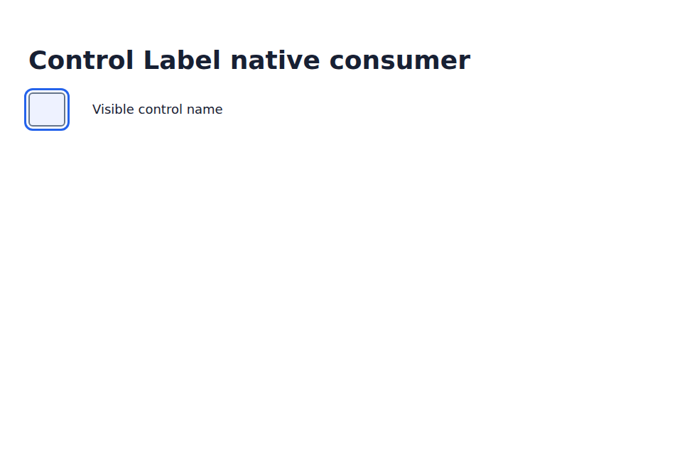
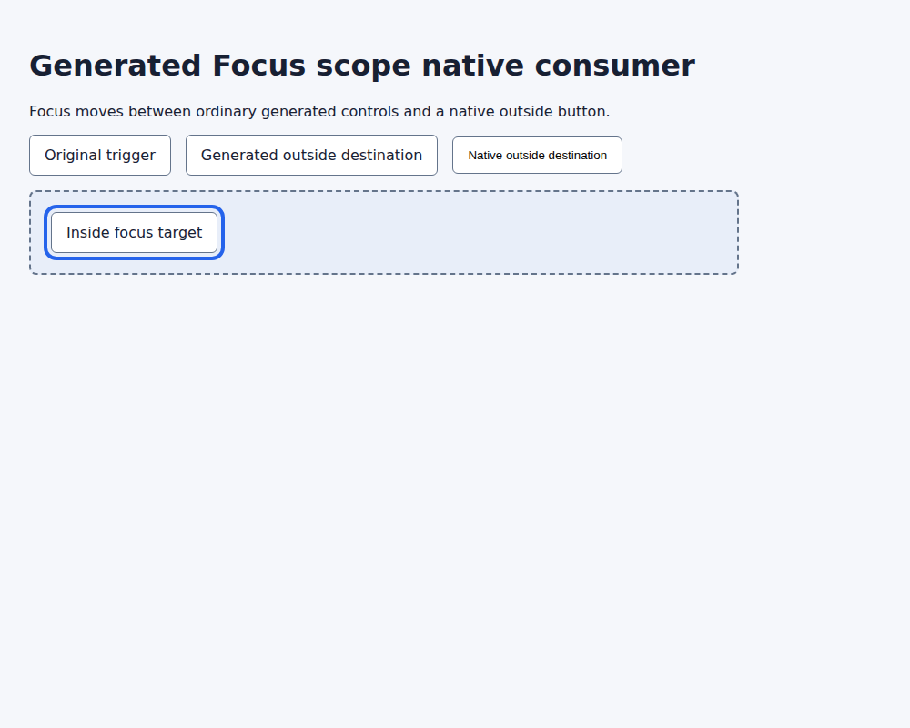

# Compiler 同源验收与 Dart Optional 返回修复

本记录续接 [原生浏览器续验与源码解析修复](2026-11-16-compiler-native-acceptance.zh-CN.md)，闭合 PR #1462 的独立依赖浏览器验证、真实 Dart 返回值缺陷、完整类型检查和官方 React 打包消费者验证。原始失败与历史证据降级保持原样；本记录不代表完整 CI、所有原生平台或发布验收已经通过。

**原十个浏览器文件在同一个干净源码版本上 97/97 通过；真实 Dart 的原六项加新增一项在两行修复后 7/7 通过；最终组合 `bfd383c468943e6145afb717b35d26dd7e23ebca` 的完整 `check:types` 和官方 packed React consumer 均退出 0。** Linux GPUI 的真实远端消费者 27/27 通过，macOS 仍是 runner 分配前取消、零执行。另一次完整网站 CI 暴露的独立失败也保留，不能将整体剩余工作缩写为只有 macOS 权限问题。

完整机器记录、原始收据与可恢复压缩附件见 [2026-11-16-compiler-isolated-acceptance.json](https://github.com/Proto-UI/Proto-UI/blob/cae25ae39f926e9556ec40fe2c7ed46a2025091f/internal/records/evidence/2026-11-16-compiler-isolated-acceptance.json)。

## 执行结果与准确源码

| 执行 | 实际源码 | 结果 | 边界 |
| --- | --- | --- | --- |
| 原十个真实浏览器文件 | `3d1fc914e5f9f7dfada8da27f61dbb92783a84bf` | 97 passed、0 failed、0 pending | 独立依赖、正常 Chromium sandbox、原测试文件和断言 |
| 原六个 Dart 用例 | 同上 | 5 passed、1 failed、0 pending | 真实泛型返回类型错误，原失败完整保留 |
| 只新增回归用例 | `61a713506be2202ed6f627d042b7fd63a303fab2` | 5 passed、2 failed、0 pending | 原六项仍为 5/1，新一项也真实失败 |
| 两行 Dart emitter 修复 | `74626818001613a5f343fed38ccbc3d42440915c` | 7 passed、0 failed、0 pending | 原六项与预期值逐字保留；新增一项单列 |
| 完整 workspace 类型检查 | `bfd383c468943e6145afb717b35d26dd7e23ebca` | exit 0，211.29 秒 | 实际源码文件清单 foreign 0 |
| 官方 React 打包消费者 | 同上 | exit 0，120.94 秒 | 重新构建和打包，42/47 个真实 tarball 包被消费 |
| Linux GPUI dispatch | `3d1fc914e5f9f7dfada8da27f61dbb92783a84bf` | 27 passed、0 failed、0 ignored | 已发布默认 SDK 检查与原 Rust consumer |
| 同一次 dispatch 的 macOS | 同上 | cancelled，0 executed | 退休 runner 配置在分配前被拒绝 |

最终组合 tree 为 `14361600e73a43b3787226f016b43e2e94fe6a06`。浏览器观察源码到最终组合的 `packages/**` 差异仅为 `flutter-source.ts` 的两处无值返回，以及新增的 Dart 原生用例；parser、IR、浏览器 emitter、Runtime、Adapter 和原十个浏览器测试文件均未改动。Dart 绿色源码到最终组合的差异为网站修复、网站测试和工程记录。依赖 lockfile、TypeScript/Vitest 配置、浏览器 harness、server-readiness、Dart host support、GPUI workflow 与相关执行源码均有 hash 对照。

因此保留浏览器在 `3d1`、Dart 在 `746268` 的真实执行归属，依据变更范围映射到最终组合，没有宣称在 `bfd` 又执行了一遍。机器附件包含 `3d1` 的 13,368 个与 `bfd` 的 13,371 个完整 Git 路径/object 清单，以及全部 25 个变更路径的前后 SHA-256。

还保留一个较宽的证据指纹差异：ControlLabel 夹具会读取 `runtime-test-plan.mjs` 的字节加入 harness manifest。本轮该文件只将 WC 的 CI owner 路径改为既有 isolation script；它不是此夹具实际导入或执行的模块。原 `3d1` manifest 仍按原值保存，没有改标为最终源码的全量相同指纹。

## 原十个浏览器文件的独立复验

环境为普通用户运行的 Node `v24.21.0`、pnpm `10.32.1`、Google Chrome `157.0.8103.38`。每次只执行一个测试文件、一个 Vitest worker，Node heap 上限 2048 MiB，未使用 `--no-sandbox`。十个原测试文件的 SHA-256 均与原 `d6c45a487` 文件一致，未增加 skip、放宽 deadline 或削弱负控制。

| `packages/compiler/test/` 文件         | 通过数 |
| -------------------------------------- | -----: |
| `control-label-native.browser.test.ts` |     24 |
| `web-component-native.browser.test.ts` |     12 |
| `browser-differential.test.ts`         |      3 |
| `browser-native-lifecycle.test.ts`     |      5 |
| `browser-pointer-props.test.ts`        |      1 |
| `browser-source-presentation.test.ts`  |      1 |
| `browser-update-intent.test.ts`        |      2 |
| `focus-scope-native.browser.test.ts`   |     22 |
| `vue2-native-editor.browser.test.ts`   |      6 |
| `browser-button-ssr.test.ts`           |     21 |

本轮生成 397 张真实 PNG，完整路径、大小和 SHA-256 清单保留。下面两张实际目检的原图同时保留在工程记录与恢复附件中，其余 395 张原图仍在执行目录，仅以索引引用，不声称已经作为文件上传。





这两张图分别支持可见名称/焦点轮廓与普通 scope 内外控件的观察；它们不扩大为所有主题、设备或辅助技术验收。Focus 原夹具的 `compiledPopoverConformance: false` 与 `cleanHeadAcceptance: false` 继续保留；通用 Light DOM Focus 消费者不能替代正式 Popover 或其他宿主验收。

## 真实 Dart 缺陷与最小修复

原始第五项中的 authored 函数为 `const maybe = (flag: boolean) => flag ? 4 : undefined`。发出的显式 return 已包装成 `NativeOptional<double>`，但 emitter 还自动追加了没有类型参数的 `return const NativeOptional.absent();`。实际 Dart 将整个闭包的返回类型推为 `NativeOptional<dynamic>`，调用处的 checked `NativeOptional<double> Function(bool)` 转换随即抛错：

```text
type '(bool) => NativeOptional<dynamic>' is not a subtype of type
'(bool) => NativeOptional<double>' in type cast
```

同样的问题存在于显式无值 `return;` 的生成分支。本轮仅将这两处改为 `const NativeOptional<Never>.absent()`，避免 absent 分支扩大正常返回值的泛型。具有参数类型上下文的 optional 默认值继续保持原实现；数字、nullable 载荷、调用参数次序和惰性语义均未改动。

新增用例真实执行三种闭包：显式 bare return、隐式 fallthrough、带 `number | null | undefined` 结果的返回。观察分别要求 present 数值为 4、5、6，absence 保持 `undefined`，nullable 分支保持 `null`。原六项的 source/expected 字节前缀相同，由 runner 显式校验。仅加测试的提交得到 5/2 红色结果；两行修复后的同一测试文件得到 7/7 绿色结果，3.43 秒、最大 RSS 237,136 KiB。既有 `flutter-call` 与 `expression-types` 两文件另有 23/23 通过。

执行 SDK 为 Dart `3.9.2` Linux x64，二进制 SHA-256 为 `042690ce066682972c5031201b339d2ef373abbf2b40ae91fa75534259826c0e`。测试复制真实 emitted setup/scalar support，通过 typed observation port 观察结果；这是 dormant direct emitter 的真实 Dart 执行证据，不是 Flutter Widget、NativeOwner 生命周期或物理 UI 验收，也没有启用公开 Flutter profile。

## 同源完整类型检查与官方消费者

独立 checkout 使用 `corepack pnpm@10.32.1 install --offline --frozen-lockfile --ignore-scripts`，`node_modules` 是独立目录，不再复用 donor workspace 包链接。最终安装 0.756 秒完成；运行前实际 TypeScript 文件清单为 workspace 8,194、website 6,298，外部 workspace 源码均为 0，且两者都包含当前 `packages/adapters/base/src/host/instance-associations.ts`。

原命令 `corepack pnpm@10.32.1 -s check:types` 完整退出 0，最大 RSS 2,762,496 KiB。Astro 最终统计 1,238 个文件、0 errors、0 warnings、30 hints，完整提示原文保留。本次结果属于修复 alias 后的 exact `bfd`；旧记录中的本地 exit 137 和 donor declaration 污染下的历史 exit 0 均不删除、不升级为此次证据。

随后串行运行未修改的 `release:smoke:react -- --keep --work-dir …` 官方脚本。它重新完成前置构建和 47 个包的 staging/packing，在仓库之外安装真实 file tarball，保留 npm peer 校验，未使用 `--force` 或 `--legacy-peer-deps`。此前本地的 offline React packument 缺失不被抹去；本轮环境已有所需缓存，实际完成安装。47 个 tarball 的大小、SHA-256、integrity、pack manifest 与 consumer lock 均保存。

最终成功行是 `release consumer smoke: react ok (42/47 packed packages consumed)`。它覆盖 CLI init/add、消费者 TypeScript 与生产 Vite build、带样式的 React 语义/CSS smoke、关闭生成样式的负控制，以及消费者主动加入完整 CSS 后的 toggle/remount。最大 RSS 为 888,868 KiB。HappyDOM smoke 原有的 CSS 适配说明完整保留；它不证明原生 cascade layer、绘制、布局宽度或 hit-testing，原生浏览器结果由上面的独立 97 项承担。

03:34:23 UTC 清理收据确认本分工没有残留活跃进程或 Chrome，源码仍 clean，随后将共享重任务时段交给网站验证。

## 远端平台事实与仍然独立的缺口

[GPUI run 43795529524](https://github.com/Proto-UI/Proto-UI/actions/runs/43795529524) 精确绑定 `3d1`。Linux job `133063369932` 完成 fresh compiler producer、默认已发布 SDK 检查与原 27 项 Rust consumer，全部通过，0 ignored。下载的 Actions artifact `14194112840` 为 1,413,849 字节，SHA-256 `287fb75d17f2340c9fcb0eeffdb7ed61c16c570f4235d88b89cbad8d4b75fc50`；203 个成员的清单、`source-sha.txt`、Rust toolchain 与原 producer/default-check/consumer 日志保留。

macOS job `133063369758` 在任何 step 执行前取消，annotation 是 `The configuration 'macos-14-arm64-us-default' is not supported`。[GitHub 官方退休公告](https://github.blog/changelog/2026-10-01-github-actions-macos-14-runner-image-retirement/) 说明 Actions 的 macOS 14 image 于 2026-11-02 退休；[runner-images 公告](https://github.com/actions/runner-images/issues/13518) 与[标准 image 清单](https://github.com/actions/runner-images/blob/main/README.md) 支持改为固定的标准 ARM64 `macos-15`。

一行 label 修复已形成可审查的 `15dacf04637781ae10ae3fe9c0311ba3526ec0a8`，保持 Rust `1.98.1`、locked dependencies、SDK 检查及原 consumer 断言。协调者的组合 `f16e854a16a7e928075aea18800992f75f463a7e` 正常 push 被 GitHub 明确拒绝：OAuth App 没有修改该 workflow 所需的 `workflow` scope。原 push exit 1 与 ref readback 仍指向 `3d1` 的收据保留。没有更换凭据、降低权限门槛或把取消转成通过。后续需有相应权限的维护者发布已备修复，再执行准确源码的 macOS 消费者。

`bfd` 的 DCO check `133072053446` 已实际为 completed/success，原 output 为 “All commits are signed off!”。该 head 的普通 PR CI [43798282345](https://github.com/Proto-UI/Proto-UI/actions/runs/43798282345) 仍只有四个轻量 job 成功，18 个重 job skipped；本轮 Box 的真实类型和消费者成功不能冒充这些未执行的 CI job。

此外，完整网站 CI [43796319938](https://github.com/Proto-UI/Proto-UI/actions/runs/43796319938) 的 `9c5cb80c4b015910fc18193b697003e2864b6b18` 在 03:35 快照中为 66 jobs：30 success、25 failure、4 in progress、7 queued。其他失败由协调者继续逐项诊断。本分工只读复核其 agent-operations job `133065841562`：1,533 项中 1,512 pass、21 fail、0 skip，21 项均来自 `connector-collaboration.test.mjs`。当前 `bfd` 对该单文件的离线复现为 29 项中 8 pass、21 fail，0.59 秒；相关 CLI、transport 与 fixture 的源码 hash 与 `9c5` 相同。具体缺口是 CLI 尚未接受并接入已有的 `--transport connector` 路径，不能归因于 runner、DCO 或旧的 CI owner。该修复作为独立受支持 CLI 回归继续处理，保留所有真实 actor、authorization、expected-head 和单次写入边界。

## 记录恢复与完成范围

机器 JSON 含八个带格式、字节数、SHA-256 和逐成员 hash 的 base64 压缩档案，共 427 个恢复成员，包括原始 5/1、5/2 与 7/0 Dart 结果，十个完整 Vitest 报告，实际消费者 trace、完整类型文件清单与日志、官方 tarball/lock 事实、源码映射和远端只读快照。恢复时先验证压缩包，再验证成员；不将历史收据改写成后续 head 上的执行。

- [x] 同一干净源码、独立依赖下执行原十个浏览器文件，97/97 且无 skip。
- [x] 修复真实 Dart Optional 返回推断缺陷，保留原六项并增加一项真实回归，7/7。
- [x] 最终组合源码的同源完整类型检查与官方 packed React consumer。
- [x] Linux GPUI 原消费者真实远端执行与 `bfd` 的实际 DCO 成功。
- [ ] macOS runner 修复的有权发布与后续真实执行，仍为独立权限/运行前提。
- [ ] 完整网站 CI 的其余失败，包括已复现的 connector CLI 接线缺口，继续各自修复与验证。
- [ ] 正式独立平台 review、最终整体验收和对应 tracking readback，由协调者按实际结果推进。

本记录是新增工程记录，不改写上一轮 donor 类型证据的降级、不重写已发布提交，也不补造历史 publisher 收据。新的记录提交使用仓库既有 `agent:publish` 路径，绑定准确 branch、parent head、staged tree 与已核当前用户身份；外部发布与跟踪写回由协调者负责。
