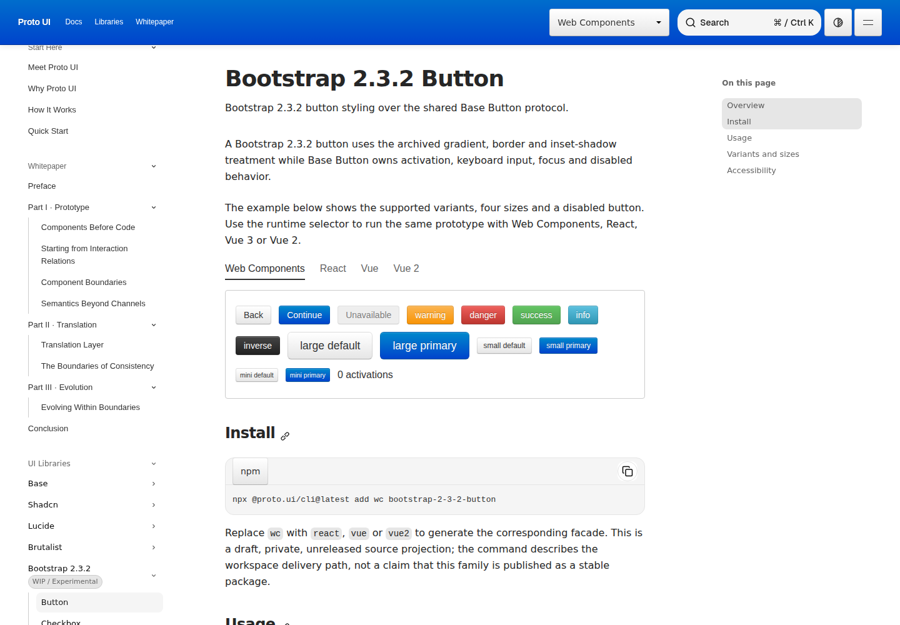
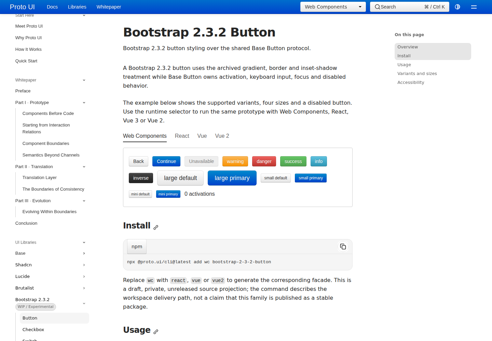
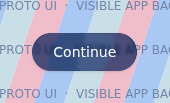
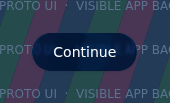

# Sprint 6：原生回读与验收前提修正

本记录保留 `afde3097f880dca9d09e9b67b40913bc1576db59` 的真实执行结果及后续修正依据。后续提交的原生复验尚未在本记录形成时执行；最终运行与精确 SHA 由 PR #1712 的验收回执接续，不能把下面的旧 SHA 改称新提交全量通过。

用户要求完成 Sprint 6、提 PR 并处理至 ready。这里记录实际完成的切片与仍未满足的条件，不把这个请求改写为仅要求部分交付。#1467、#1148、#1149、#1049、#1050、#1053、#799 及其父追踪的完整原条件继续保留。

## Bootstrap 的实际终态

[run 45018120859](https://github.com/Proto-UI/Proto-UI/actions/runs/45018120859) 的完整 job `137194765805` 成功，包括同 runner 的基线采集与 worktree 回收。

| 范围 | 实际结果 | 边界 |
| --- | --- | --- |
| 八部分控件 | 15/15 native cases；720 个原 paint 字段与参考无差异 | 32 个实际 editor 为 inline-block，父级为普通 block consumer slot；不是通过删除 display 断言解决旧失败 |
| 顶栏 | 12/12 顶层测试，38/38 cells，208 张图；page / cleanup / protocol errors 均为空 | 四首页宿主及实际 Docs 路径；完整家族、物理输入与其他平台不由此接受 |
| Button 运动 | 8/8 顶层测试，96/96 cells；216 条原始子观测 | 88 次进入、88 次即时退出、32 次取消及 8 次保留的 reduced-motion 对照；每次进入有 5–6 个实际中间帧，100 ms 与 trusted transitionend 0.1 s 均有观测 |
| 同环境基线 | 12/12 captures，36 张图，无 page errors | measured source 为 `dc3b184ba10b0de53e40359c52d012b204b2cd01`，采集脚本来自 `afde309` |

独立评审实际打开了桌面、窄屏、浅色、深色与焦点图片。Docs Theme 的白色图标现在位于透明蓝底上；Search 使用 Bootstrap 的 4 px 圆角与渐变，声明家族和主题往返后状态也通过原生检查。原 `647ee7a` 的白图标浅底和错误 Search 家族图片仍保留在旧运行，不能因当时自动矩阵通过而抹去。

下列两张来自同一次 Actions、同一 1440×1000 视口、WC runtime、浅色与 closed 状态，均为 artifact 原字节。

### 修改前：`dc3b184`

### 修改后：`afde309`

另外保留[桌面实际焦点](https://github.com/Proto-UI/Proto-UI/blob/cae25ae39f926e9556ec40fe2c7ed46a2025091f/internal/records/evidence/2026-11-22-sprint-6/afde-bootstrap-docs-desktop-focus.png)及[390 px 深色展开面板](https://github.com/Proto-UI/Proto-UI/blob/cae25ae39f926e9556ec40fe2c7ed46a2025091f/internal/records/evidence/2026-11-22-sprint-6/afde-bootstrap-docs-mobile-expanded.png)。所有文件、原 artifact 文件名、执行 SHA 与 SHA-256 见[图片清单](https://github.com/Proto-UI/Proto-UI/blob/cae25ae39f926e9556ec40fe2c7ed46a2025091f/internal/records/evidence/2026-11-22-sprint-6/afde-visual-evidence-manifest.json)。这些图片没有生成、重绘或像素编辑。

### 自动通过之后发现的真实 focus 缺陷

继续查看同次运行的 390 px 深色焦点图时，独立评审发现 Docs 菜单环是近黑色，而同主题、同视口的 Homepage 为白色。实际 PNG 环上像素为 RGB(23,23,23)，与旁边实际蓝色像素的中点对比约 1.9882；Homepage 控制为 RGB(255,255,255)。原 suite 只检查 `ring width=2px` 后截图，没有记录焦点阶段 computed color，不能将非焦点 `command-paint` 记录挪作该证据。

源码 `ring-primary-foreground` 引用当前页面 palette；Docs 深色页面的继承值无法保证 `P-BUTTON-NAVBAR` 已声明的 white 2px。这个问题归于 Bootstrap 导航投影，不能以矩阵绿色作为通过该条件的证明。修复需在声明的投影责任层固定焦点颜色，补实际颜色与主题往返断言，并重新执行受影响的 Bootstrap lane。

后续修复在已有有限 physical utility 中增加 `ring-white`，只让 Button / Surface 的 navbar 分支使用它；普通 Search / More / Retry 仍使用其 semantic ring，不把白色字段强制改成白环。document / Shadow / split 三条真实 CSS lowering、旧源八个有效负控，以及修复后的六文件 148/148 通过；七文件 scoped types 通过。新增 native 断言将记录实际 ring color、offset 和包含纯白 2 px 层的完整 box-shadow，并采集 Theme 切换与恢复两次 focus 图。程序化 `.focus()` 只作为真实 focus paint 观察，不能写成物理键盘验收。

额外完整 Search / Theme 消费测试命令被 SIGKILL，未形成完整用例终态；后续只选择受影响的两个 Bootstrap 命令案例及三个 Theme startup 案例，5 passed / 58 未选择。未选择的 58 项不计为通过，完整命令的失败保留。

正式生成器默认及 768 / 192 MiB 堆限制运行先后被 SIGKILL，没有生成修改；不能单凭信号断言 OOM。使用相同生成源码、完整输入和原拒绝门槛，将继承的 Node 堆限制为 128 MiB 后，在 201.43 s 完成，最大 RSS 475780 KiB。生成产物实际为两条导航规则的移除与两条白色规则的加入，没有手工编辑。正式 `--check` 与新 native 结果在冻结候选后继续回读。[本地原始记录](https://github.com/Proto-UI/Proto-UI/blob/cae25ae39f926e9556ec40fe2c7ed46a2025091f/internal/records/evidence/2026-11-22-sprint-6/fifth-local/manifest.json)保留有效负控、148 和 5 项回归、70 项整合、10 项工作流/清理门槛以及资源失败与生成终态；作用范围没有扩写为全工作区通过。

两张均为原 artifact 字节。来源、hash 与逐像素观察见[缺陷清单](https://github.com/Proto-UI/Proto-UI/blob/cae25ae39f926e9556ec40fe2c7ed46a2025091f/internal/records/evidence/2026-11-22-sprint-6/afde-navbar-focus-defect-manifest.json)；新提交的实际修复结果由后续原生回执接续。

## Liquid 主套件：先保留失败，再修责任层

[run 45018126008](https://github.com/Proto-UI/Proto-UI/actions/runs/45018126008) 的主 browser job `137194782912` 为 failure，两个独立阶段均已留下完整终态：

- material / library：953 项中 952 passed、1 failed、0 pending；唯一失败是实际 Docs 容器交接诊断的 boundary 对照。
- state-controls：70 项中 54 passed、16 failed、0 pending；其中 39 个 helper tests 通过，31 个 native cases 为 15 passed / 16 failed。16 个失败均在 composition-end 的 trusted 前提，四宿主、两种 editor 和两种 owner 都确实执行。

### 真实内容宽度边界

旧诊断在 1440 px 视口读取左右各 28.8 px 的 `2vw` padding，再用这个旧 padding 预测新视口。视口改为 1377 / 1378 / 1379 px 后，padding 跟随视口改变，实际 contentWidth 相对 1320 px 阈值分别为 **+1.92 / +2.88 / +3.84 px**。因此，标记为 below / at / above 的三个对照实际都在上方，原严格 0.5 px 门槛正确报告失败。

原 9 个案例的三帧 baseline 已稳定；本次失败不是要放宽此前的稳定性、handover 或实际 CSS 规则。修正只为这三个边界对照按真实 computed contentWidth 校准 viewport：最多 8 次，保留每次请求宽度、实际宽度与误差，不收敛即失败。原 ±1 / 0 px、严格差值小于 0.5 px、9 cases、3 帧 baseline、6 帧 handover、1 px 几何和完整恢复条件保留，并新增实际 predicate 的 below / at / above 检查。产品 CSS 没有改动。

新增 7 个 helper tests 包括旧单次预测的三个真实数值反例、无法到达边界、恰好 0.5 px、未实际调整 viewport 和无效测量；本地通过。它们证明校准与拒绝边界，不替代最终浏览器文件的重验。

### Composition 的真实事件来源

原 16 个案例的 48 条 input 均为 trusted；compositionstart 和三条 update 为 true，只有 compositionend 为 false。原事件、值和顺序保留在原始 manifest。**旧失败之后的显式 owner 接受、完整 composition request 对照及最后的 identity 断言尚未执行，不能记作已通过。**

与此次浏览器一致的官方 Chrome `157.0.8103.78` 源码表明，update 经 [EventTarget::DispatchEvent](https://github.com/chromium/chromium/blob/157.0.8103.78/third_party/blink/renderer/core/dom/events/event_target.cc#L882-L886) 设置 trusted；[结束事件直接进入 scoped dispatch](https://github.com/chromium/chromium/blob/157.0.8103.78/third_party/blink/renderer/core/editing/ime/input_method_controller.cc#L315-L339)，由 [ScopedEventQueue](https://github.com/chromium/chromium/blob/157.0.8103.78/third_party/blink/renderer/core/dom/events/scoped_event_queue.cc#L75-L78) 调用 [EventDispatcher](https://github.com/chromium/chromium/blob/157.0.8103.78/third_party/blink/renderer/core/dom/events/event_dispatcher.cc#L109-L129)，没有经过这个设置。基础 [Event 构造](https://github.com/chromium/chromium/blob/157.0.8103.78/third_party/blink/renderer/core/dom/events/event.cc#L78-L101) 的初始值为 false；[CompositionEvent](https://github.com/chromium/chromium/blob/157.0.8103.78/third_party/blink/renderer/core/events/composition_event.cc#L37-L49) 和 [UIEvent](https://github.com/chromium/chromium/blob/157.0.8103.78/third_party/blink/renderer/core/events/ui_event.cc#L37-L52) 没有另行设置它。两名执行者分别读取相关官方内容，并对七份完整来源副本核对 Git blob / SHA-256。

这解释了观察值，但不能单凭源码把本次所有 false 认作原生来源。因此每个既有 composition case 增加同浏览器、同初值、同 CDP 步骤的独立裸 input / textarea 对照。两条事件序列完整比较构造类型、实际目标、来源、顺序、数据、值及 flags。应用脚本启动前安装的只读 dispatch 观察器原样转发调用，每次事件和读取均验证其身份。另实际派发一个 synthetic end，要求明确因 script dispatch 被拒绝，避免仅凭 false 标志把合成事件当原生事件。

原 start / update 与全部 input 的 trusted 门槛、逐条 valueChange、受控拒绝与接受、状态和 DOM identity 断言保留；end 的实际值不重命名为 trusted。当前 [C-TEXT-CONTROL-0001](../../../../spec/contracts/C-TEXT-CONTROL-0001.yaml) 仍是 draft，C/D/E 的原生顺序、事实与 owner 边界未改动。没有物理 OS IME 接受声明。

该切片只修改 Liquid browser suite，新增独立 helper / tests；既有 `native-editor-evidence`、产品 fixture 和 Bootstrap 消费路径保持原字节。leaf 的 43/43 helper tests 和 scoped types 通过；整合后的 5 文件 70/70 本地回归通过。16 个裸原生对照与真实合成负控是否通过，仍需后续精确 head 的 Actions 回执。

中间本地 helper 测试曾为 37 passed / 1 failed：HappyDOM 15 的 CompositionEvent/dispatch 路径不具备该浏览器前提，不能用它代称真实合成 CompositionEvent 的验证。原[失败日志与边界](https://github.com/Proto-UI/Proto-UI/blob/cae25ae39f926e9556ec40fe2c7ed46a2025091f/internal/records/evidence/2026-11-22-sprint-6/composition-local-premise-failure.json)保留；这次中间测试未冻结精确源码，不能当作精确源版本的产品负控。后续本地只验证实际 EventTarget 转发，真正的 CompositionEvent 负控留在原生浏览器案例中。官方来源的七份完整文件摘要见[参考清单](https://github.com/Proto-UI/Proto-UI/blob/cae25ae39f926e9556ec40fe2c7ed46a2025091f/internal/records/evidence/2026-11-22-sprint-6/chromium-157-composition-reference-manifest.json)，没有把它们当作已执行的裸 editor 结果。

## Program clear 的冻结视觉控制

[frame run 45018131381](https://github.com/Proto-UI/Proto-UI/actions/runs/45018131381) 的 job `137194798415` 为 failure。旧 `19d175f` 与当前 `afde309` 都用了 `style-fill`，但当前 profile 6 有意改变 tint / source-tone 算法，跨版本首帧 PNG 的相等断言失败。

原始数据中，旧版第二次渲染的 `gpu-prefilter-failed`、GL 1282 与 retired program 重绑确实复现；当前 clear 前后 PNG 自身相同、GPU 重新准备、无错误和资源清理条件成立。逐项回算只有跨版本 first-image hash 不同。前置失败使 candidate-release 步骤没有执行，后面的 required gate 因缺失 vitest.json 失败；既不能把它当产品 release 失败，也不能记成通过。

修正把这条生命周期控制固定在两版本都支持的 neutral regular 路径，显式冻结原黑场、尺寸、几何、foreground、完整 source pixels、共享 kernel 和实际提交的 vertex / fragment SHA-256。shaderSource 观察器原样转发，不替换 shader、不额外调用 getError。跨版本首帧相等、当前 clear 前后相等、旧 GPU 错误与退休重绑、计数、clear / dispose 资源条件全部保留。

原 validator 上新增条件产生 2 条有效负控失败；修正后 4/4 Node tests 通过。独立评审确认双方真实共享 neutral 代码与常量。新 GPU 控制与此前未执行的 release 阶段尚待精确 head 的真实复验。

## 本轮性能原值

同探针、工作负载、浏览器、lockfile 和 fixture 的匹配比较为 `49fc3ac` → `afde309`。这是 SwiftShader、约 60 Hz rAF 的应用观测，非物理 120 Hz 或 input-to-photon 测量。

| 60 次独立 fresh press / 模式 | baseline handler→commit p95 | candidate handler→commit p95 | candidate event timestamp→commit p95 | candidate >10 ms，handler / event |
| --- | --: | --: | --: | --: |
| static | 19.530 ms | 16.810 ms | 17.115 ms | 26 / 27 |
| dynamic | 66.470 ms | 67.805 ms | 68.105 ms | 46 / 52 |

每版 120 次都 resolved，无 untrusted input、失配 pointer identity 或 release failure。动态 p95 在这个匹配运行中没有改善；**10 ms 原目标未达到**。四宿主 source-progress 的两个窗口无 source revision 跳跃、顺序错误或停滞记录；cleanup 和后续两次 rAF 观察的 contexts / consumers / pendingImages / pendingTasks 为零。这些局部正确性结果不能替代帧率与物理延迟目标。

## 光学结果不按绿色 job 汇总成全通过

已完整回读的 WC、React、Vue 3 与 Vue 2 prominent 分区各有 14 cases / 422 captures，所有 subject PNG 的 SHA-256 与 manifest 相符。每宿主的 24 个背景 pair 为 **14 passed、2 inconclusive、8 diagnostic-only**，四宿主数值摘要一致。两个 dark Button pastel 的 neutral 控制自身信号不足，tinted 结果也未达到原 span / delta 门槛，不能说全部光学通过。

原 WC 四个失败已在同宿主取得反证：[原始逐项比较](https://github.com/Proto-UI/Proto-UI/blob/cae25ae39f926e9556ec40fe2c7ed46a2025091f/internal/records/evidence/2026-11-22-sprint-6/wc-original-failures-comparison.json)绑定 `9b6448e` → `afde309`，4 类 × 2 帧 × neutral / tinted / opaque 共 24 组。两名执行者从原始 frame JSON 核对 source pixels、完整 crop、rect、geometry、raster、cells、exclusions、foreground 和 ROI；neutral / opaque 的全部 metrics 保持原值。四个 tinted 失败均在原门槛下通过，例如 light Button text span 7.6816→10.6315、dark Submit text delta 3.1432→4.8476。实际查看旧新 WC light Button 与 dark Submit 图片后，视觉变化有限但结构得以保留；这些反证不能推广为 Apple 外观完全接受或消除另外两个 dark Button 的不足。

visible-refraction 诊断的 64 帧为 38 insufficient / 20 unresolved / 6 resolved；相对旧运行新增的两个 resolved 是同一个 light-submit 的 rest-before / rest-after，不能计作两个独立新场景。其 scripted renderer 没有真实组件 foreground glyph，productAccepted 仍为 false。

tint-stage 的 60 帧库存和 552 个文件完成，但 28 个 stage 帧明确为 historical profile 4 replay，currentProductValidation=false；它保留原拒绝与 dark Button neutral 不足，不能借当前 profile 6 host 名义宣称产品接受。

同轮其余八个 prominent / hover 分区现均完成，分别为 56 cases / 1688 captures 与 16 cases / 176 parts / 2880 captures。原 prominent 48 / 1608 和新增 constant-field 8 / 80 分别核对，没有缺项或意外项。逐一核对了 1688 个 prominent subject PNG、2880 个 hover root、2880 个 context 和 2272 个存在 material 的 PNG，均与原 manifest 匹配；无 page / cleanup 错误。合计 96 个背景 pair 为 56 passed / 8 inconclusive / 32 diagnostic-only，不能与 56 个行为用例混为一项指标。

完整终态、原 ZIP digest、raw JSON/hash、实际目视范围和各 job / artifact 永久链接见[八分区清单](https://github.com/Proto-UI/Proto-UI/blob/cae25ae39f926e9556ec40fe2c7ed46a2025091f/internal/records/evidence/2026-11-22-sprint-6/afde-selected-eight-lanes-manifest.json)。其中本地绝对路径仅记录采集出处；公开回读以同条目的 Actions artifact 链接为准。该清单仍绑定 `afde309`，不声称后续提交重新执行了八个分区。

这些 artifact 的原保留期为 30 天，URL 稳定不代表 ZIP 永久可下载。因此另保存了[八分区原 JSON 归档清单](https://github.com/Proto-UI/Proto-UI/blob/cae25ae39f926e9556ec40fe2c7ed46a2025091f/internal/records/evidence/2026-11-22-sprint-6/afde-eight-lane-archive/afde-eight-lane-archive-manifest.json)及 28 份确定性 gzip，包含每个 results 和相应 plan / progress / checkpoint / source 记录，共约 1.99 MiB 压缩数据。每份先与原 ZIP member 比较，再解压逐字节回读，并分别记录压缩和原始 SHA-256；没有以摘要替换完整结果。

## 按实际改动复验

material workflow 新增显式 `workflow_dispatch` 的布尔 `browser_only` 参数，默认 false；`workflow_call` 保持完整库存，不开放裁选参数。只有明确手动选择 true 才不选其他十个分区，main 的完整 material / library、31 个 state-controls 及两个强制终态 gate 仍执行。selection.json 记录 source、run / attempt、workflow hash、selectedJobs 与 notSelectedJobs；未选择不计为通过。

其他未修改分区只在原运行完整终态、输入闭包的真实变化与影响经独立评审时复用，并保留 executedSha=`afde309`。逐路径 hash 比较和任何共享生成文件差异必须明确列出；不能把旧执行 SHA 改成新 head。Bootstrap 焦点投影、portal / composition suite、program-clear 与 release 必须在后续精确 head 真实重跑。最终报告、PR 状态、CI/DCO、独立审查及可逆 ready 操作单独绑定该 head。

焦点修复确实改变了两个 Liquid 专用页面导入的共享 draft CSS，不能声明完整页面输入逐字节未变。[独立实际渲染比较](https://github.com/Proto-UI/Proto-UI/blob/cae25ae39f926e9556ec40fe2c7ed46a2025091f/internal/records/evidence/2026-11-22-sprint-6/fifth-draft-css-comparison.json)表明：Bootstrap 664 个 token 中只替换两条 navbar ring；Liquid 451 个 token 保持原字节，document / Shadow / split 三路输出也保持原字节。两家族并集仍为 811 个 token，共同 809 个的全部输出相同；完整并集 CSS 的移除/新增选择器均为 Liquid 未使用的 navbar ring。复用须保留这项明确差异及静态消费闭包审查，不能把它写成整页输入完全相同。

## 原始证据与未完成条件

六份原始失败 JSON 使用确定性 gzip 保留；[清单](https://github.com/Proto-UI/Proto-UI/blob/cae25ae39f926e9556ec40fe2c7ed46a2025091f/internal/records/evidence/2026-11-22-sprint-6/afde-failure-evidence-manifest.json)同时记录压缩和解压后的 SHA-256 / bytes、执行 SHA 与 run。它们包含原 material 和 state-controls Vitest 输出、完整 composition manifest、portal 边界诊断、原 program-clear 和匹配性能数据，均未改写为成功。

全库逐 part、Apple 实际投影接受、原 120 Hz / 10 ms、物理 OS IME / AT、Compiler 与非 Web 条件继续开放。真实 Harness 应用是 [shenko](https://github.com/cyjin-yl/shenko)，另一个实际消费者是 [OpenGreendam/verdant](https://github.com/OpenGreendam/verdant)；本轮核对其已有 source pins，没有升级其 pin、替换其家族或把内部 fixture 当实际 App 运行结果。
