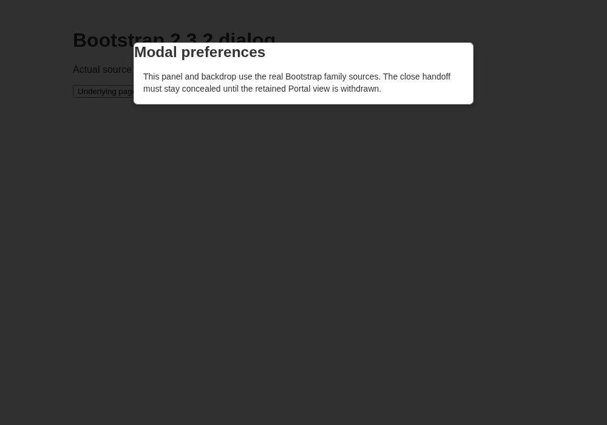
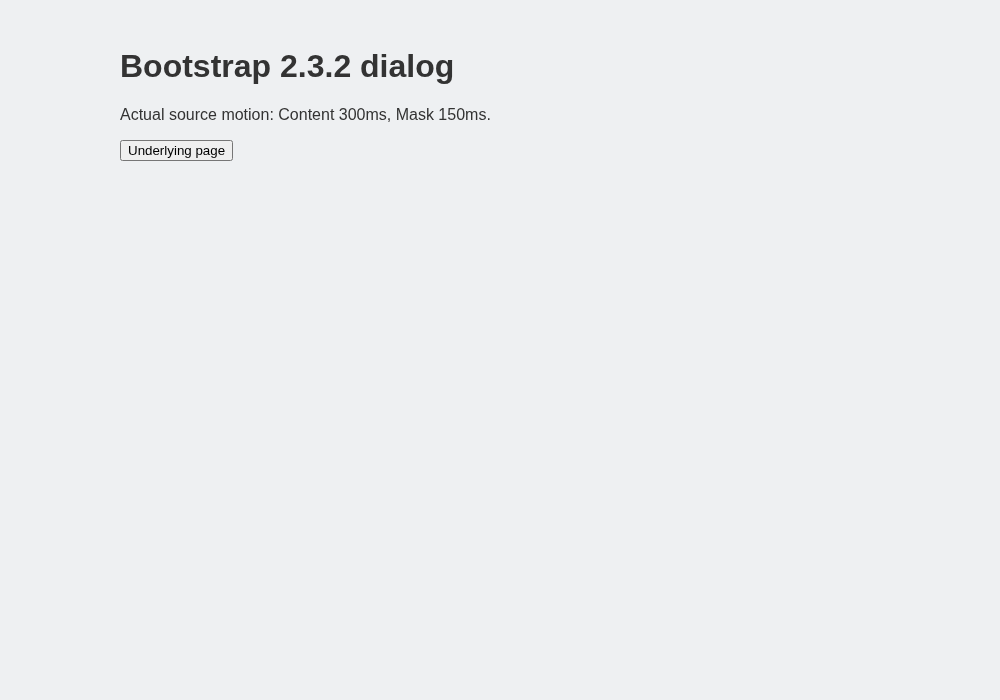

# Sprint 6 main integration and retained-view retirement

This bounded update reconciles PR #1712 with main and preserves the concurrent Dialog, FocusCenter, and Vue2 lifetime repair. It restores one demonstrated Web Component event-delivery regression and corrects evidence observers whose old marker assumptions no longer describe the current host contract.

## Source boundary

- Branch parent: `23122cbfac09434fa8697dba5e153812b2434bf2`.
- Merged main: `457d27f7fe554f398970a836ee9c95edb4846f47`.
- Prepared product/test tree before this evidence-only record: `52b7a598eecf543d5290a7cab62625d21357bb22`.
- All eight files from concurrent commit `23122cbf` retain their exact bytes. This update does not replace its close-request Root/run identity, active-focus scope, Vue2 physical-generation cache retirement, or Navbar diagnostics.
- The earlier `831bf10` plus `9acf433c` experiment and its failures are kept under `prior-831/`. Its results are attributed to that earlier combination.

[The manifest](https://github.com/Proto-UI/Proto-UI/blob/cae25ae39f926e9556ec40fe2c7ed46a2025091f/internal/records/evidence/2026-11-23-sprint6-main-view-retirement/manifest.json) contains source hashes, actual file selections, and both compressed and original hashes for every retained raw artifact. Gzip files preserve original bytes.

## Merge decisions and product repair

The six manual conflict resolutions retain both parents' intended guarantees. `T-FEEDBACK-PRESENCE-PRESENTATION-0001` keeps the exact union of 19 implementation objects and 11 cases, including each original passing/planned value. The Bootstrap Text resolution retains defined rem metrics and the authored selection/slot behavior. Automatic Feedback numeric-State identity, Runtime registration, generated tokens, and owner registrations are preserved.

For Web Component views, `data-pui-view-detached` projects not-present intent immediately. The shared rule is `display: none !important`. The existing two-RAF conceal barrier retains the owned DOM projection and real mount epoch; it does not promise a visible layout surface. Request-version guards, owned style/inert restoration, and main's first-render acquisition transaction remain in place. First-render suppression still applies only to a fresh acquisition and is released in its original transition-guard/display order.

One additional product repair is limited to `setViewDetached(true)`: disable the old event gate before toggling the native attribute. A synchronous attribute reaction may reopen the view through public Props. With the old order, the old close continuation then disabled the newly reopened gate. The false branch and its current gate/instance/connection/terminal guards are unchanged. The actual `disable()` implementation only assigns an internal boolean and invokes no user callback.

The final same-fixture counterfactual failed with press count 1 instead of 2 using Adapter source `72a3553f59ae5409b74140d655490bf1565bf30fb029e7ce7817ea1aaa2c8287`. The repaired Adapter hash is `87ba7e69539e0eef6ada38b133103f8be97d5336e284014bb07bdbc5c83bef22`; the fixture hash is `ed99cb1c77ce6a19871eb2c452efca2d9d31cc90c67937675d90d55db1f7fedd`. The complete Portal and first-render files passed 33/33 with no skips. Both files also passed on the current `23122cbf` combination before the later observer-only changes.

This regression is Happy DOM/DOM evidence with synthetic MouseEvents, not new OS-native input evidence. An intermediate fixture had observed only microtasks after Root removal: press delivery was fixed, but its cleanup observation was too early. The final fixture follows the existing real `setTimeout(0)` MutationObserver-delivery pattern and preserves Root removal and exact mount/unmount/dispose counts. That intermediate failure is retained; no product cleanup fix is attributed to the fixture correction.

The final workspace typecheck found two `unknown` values captured by the test's class methods after a valid runtime guard. The test now captures the guarded array and callback in two local const aliases. The guard, callback, assertions, and product source are unchanged. With final fixture `6109f9a7d025b75631dbc16006ee61466c99d08d64594249ffd34b2390bde242`, the same old helper failed the one selected press-count assertion again (30 other cases intentionally excluded by the single-case filter), and the fixed helper passed both complete files, 33/33 with zero pending. The final workspace typecheck then passed. The original two type errors, narrow alias diff, counterfactual, and complete green JSON are retained separately. The prior 25-file/243 source selection and 450-input native bundle exclude this Portal test fixture; their tested input bytes are unchanged.

## Modal observation and strict evidence inventory

Six source Modal assertions previously expected a false detached marker after the semantic phase closed. They now verify the actual marker meaning while also requiring the original physical Portal projection, connected host, same presentation owner, owned hidden/opacity/inert state, and original two frames. The final frames must withdraw the physical projection. All 18 source cases passed.

The real browser producer and Node refusal controls import the same pure `scripts/test/bootstrap-modal-observation.ts` predicates. Browser completion waits for actual projection withdrawal and an acknowledged unmount of the same owner/epoch/created/mounted lifetime. Its retained-barrier condition requires an active physical mount and conceal/inert facts. Reversal assertions separately cover leaving and closed-barrier states.

Independent review found that an early version could confuse a disconnected host with ordinary not-present retirement. The exact same final Node fixture first failed 80/81 with `connected:false`, then passed 81/81 after adding the connected-host requirement. The original helper, raw red/green logs, and source review receipt are retained. The native observation watchdog remains 1000 ms, with the original two trailing frames; no timing or style tolerance was widened.

The canonical motion inventory is 11 files and 130 assertions: Portal grows from 30 to 31 because of the actual event-gate regression. Its exact title must appear once and pass. Missing, replaced, duplicate, skipped, or unrelated green cases cannot substitute for it. The 12 native positive scenarios and one unsupported split refusal are unchanged. Node controls are synthetic protocol and observation controls; they do not constitute native execution.

An existing workflow test selected the first arbitrary upload-artifact step, which had become the earlier, independent motion uploader. The actual state-controls uploader was already after its own receipt gate. The test now requires exactly one uploader with that gate's exact evidence path, plus the original ordering/always requirements and the correct artifact name and missing-file failure. No workflow execution/upload ordering was moved.

## Catalog repair

Main itself contained two `HC-CONTROL-LABEL-0001-GPUI` criteria with the same ID. The real loader rejected that entity, producing one duplicate-ID problem and seven unresolved references. The repair conjunctively combines both complete original English paragraphs under their existing single ID. Exact Window, semantic node, current frame, release-coordinate, checked-pair, callback, passive-child, stale-lease, and unsupported-input restrictions all remain.

Independent deep comparison verifies that every other criterion, including `GPUI-OPAQUE-CHILD`, and all lifecycle, sources, mappings, revisions, and other fields are unchanged. Status remains draft; this repair adds no Compiler implementation or native-input/assistive-technology acceptance. The real loader now returns 1319 entities and zero issues.

The unchanged authoring CLI with the actual main base still fails while parsing that base at its existing duplicate criterion, before comparing the repaired working tree. The original command, actual base SHA, exception, and log are retained. No alternate base or added checker tolerance is used to claim a pass.

## Actual current executions

| Evidence | Observed outcome |
| --- | --- |
| Initial current source baseline | 93 executed: 86 passed, six stale Modal assertions failed, one graph assertion timed out; zero skipped/pending |
| Existing Node producer controls | 76/77 before the exact uploader selection correction |
| Final Node producer/observer controls | 81/81, zero failed/cancelled/skipped/todo |
| Peer-review physical-lifetime counterfactual | Same final fixture: 80/81 red, then 81/81 green |
| Current source combination | 25 files, 243/243, zero failed/pending; exact original per-file counts retained |
| Relevant catalog/schema fixtures | 4 files, 8/11 passed; 3 original 5000 ms timeouts; zero pending |
| Real Chromium Modal | 6/6, zero failed/pending; version 145.0.7632.6 with sandbox enabled |
| Actual catalog loader | 1319 entities, zero issues; exact criterion conjunction checked |
| Authoring against actual main457 | Base parse failed at its inherited duplicate GPUI criterion before current-tree comparison; retained as failed |
| Original graph Vitest deadline | Retained 5000 ms timeout, including one isolated attempt after the browser ended; not relabeled as passed |

The current source group keeps the 22 other files from the earlier 23-file selection and adds the three concurrent Vue2/Focus files. The graph assertion is reported separately with its original failure, rather than omitted from the declared gate or counted green. The four schema files independently executed 11 assertions: eight passed, and the Adapter-profile alignment plus two Feedback catalog-alignment assertions reached the original 5000 ms limit. Those three failures are retained without another retry or a changed timeout. The two full Portal files already passed 33/33 on this same current product source. Hosted CI still owns its complete original graph/schema and motion selections.

The first native attempt generated the actual bundle but did not execute any case because Chrome was not found. Its 0-executed/6-pending result and setup error are retained. The next attempt used the existing Chrome executable via the supported `CHROME_PATH` and an owned short temporary directory. It passed all six cases in 44.427 seconds. Both attempts have the same bundle `67443978c74b0e4e20bcf0a6fb227c9ccc3f07a5e42bfb42d21bfa918a522a37`. All 450 recorded source inputs were read back unchanged. Every original case JSON, image, bundle, stylesheet, and source manifest is retained.

An independent readback verified all 25 native artifacts and their source bindings. For both families, Content and Mask each have two retained-closed samples with connected/portaled/marker/inert/concealed facts and the same owner/epoch/one-mount/zero-unmount lifetime. Their terminal close samples remain connected, are no longer portaled, and show one mount/one unmount without owner or epoch replacement.

Two original native PNGs were visually inspected: the entered state contains the authored Dialog and backdrop; the terminal close state contains the underlying page with both removed from paint. The physical lifetime facts remain in the case JSON.

### Command receipts

These are actual executions on the prepared tree. Outer process bounds do not alter the original testcase, motion, or catalog assertions. The website companions were generated from the actual public CLI before workspace types.

| Command receipt                    | Exit | Seconds |
| ---------------------------------- | ---- | ------- |
| `source-stage`                     | 0    | 0.616   |
| `validation-route-final`           | 0    | 1.182   |
| `graph-isolated-after`             | 1    | 13.71   |
| `spec-loader-diagnostic`           | 0    | 5.035   |
| `current-draft-token-generate`     | 0    | 234.824 |
| `current-draft-token-check`        | 0    | 162.654 |
| `combined-current`                 | 0    | 292.1   |
| `schema-current`                   | 1    | 33.696  |
| `current-spec-authoring`           | 1    | 6.713   |
| `current-prototype-catalog`        | 0    | 5.475   |
| `current-cli-build`                | 0    | 7.131   |
| `current-website-generate`         | 0    | 114.107 |
| `current-type-contracts`           | 0    | 39.468  |
| `current-workspace-types`          | 2    | 128.192 |
| `current-union-readback`           | 0    | 0.618   |
| `current-source-whitespace`        | 0    | 0.519   |
| `current-no-tracked-drift`         | 0    | 2.52    |
| `fixture-type-format`              | 0    | 2.471   |
| `fixture-type-stage`               | 0    | 0.064   |
| `fixture-type-counterfactual`      | 1    | 16.012  |
| `fixture-type-green`               | 0    | 5.174   |
| `current-workspace-types-repaired` | 0    | 75.35   |
| `fixture-type-whitespace`          | 0    | 0.065   |

## Review and acceptance boundary

The bounded product and conflict resolutions received local independent source review. The final eight-file observer/inventory/catalog patch also received independent source and raw-evidence review; its concrete connected-host finding was fixed and demonstrated by the same-fixture red/green result. These reviews are not GitHub APPROVED reviews.

The local graph and three catalog/schema timeouts, and the invalid main authoring base, remain actual limitations. A new exact-head Bootstrap workflow with public-package validation must establish its original hosted graph/schema, browser, build/budget, React, and CLI gates. Historical `831bf10` Liquid, matched, and Select/Text runs stay attributed to that SHA. No parent issue, lifecycle promotion, physical 120 Hz/input-to-photon, Apple comparison, assistive-technology, or non-Web requirement is closed by this bounded integration. This record does not merge the PR.
