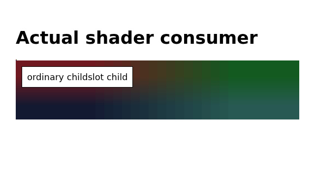
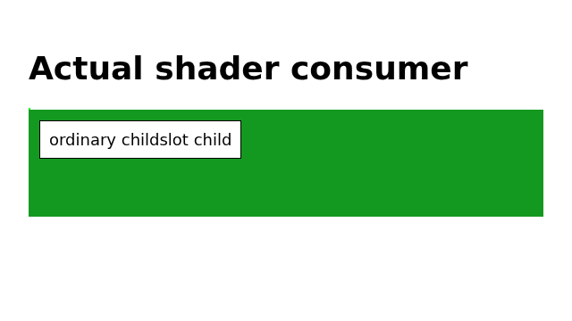
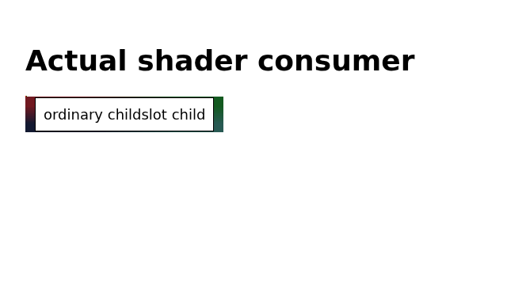
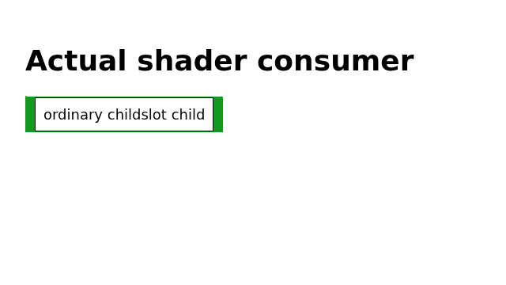
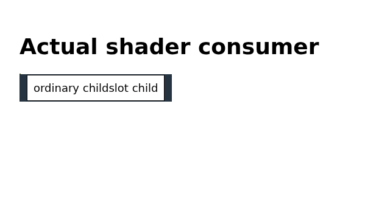

# Sprint 4：有界 scene 浏览器证据收尾

本目录保全 c1 的真实浏览器原件和两轮独立事实审阅。**37/37 浏览器旅程、106/106 生成产物及 16 张 active paint 原图的有界接受已经完成；数值提交 c18bf8f8 的最终严格预算已实际通过 9/9 并完成独立原件复核。** 这不是整个 Sprint 4、#1143 或 #1089 的关闭决定，也不是正式 GitHub APPROVE。

## 来源与结果

| 项目 | 真实来源与接受范围 |
| --- | --- |
| 产品实现 | `9fff88cf23d4e55375979bc5c68c033e3deaed38`；后继浏览器测试与上传修复未改产品源 |
| 浏览器执行 | [Actions 45266835323](https://github.com/Proto-UI/Proto-UI/actions/runs/45266835323)，head `c1f0332eed6ba79734b92bd4407b274f45d5c274`，tree `ef4ef8fb55f867f41d70717dde180f04d1233d1c` |
| 功能分母 | 原 28 条 + scene 9 条；37 个唯一 fullName 精确匹配提交清单，37 passed，0 failed/pending/todo |
| 闭包 | 3 fixtures × React/Vue/Vue2/WC 四 profiles，106/106 生成产物大小和 SHA256 匹配，含 70 个此前遗漏的生成支持文件 |
| 原件 | 250 个唯一常规文件，原始归档 3,141,207 bytes，SHA256 `22da92c2a76be6a901f0cb9ea294d22f592d8a438ca1efc9684701e29c5ac2f0` |
| 独立来源检查 | 608 份唯一 Git 源 blob、generator 聚合、lock、三份 entry/bundle hash 对应实际 c1 |
| 隔离 | UID 1001、capability 全零、独立 user/net namespace、仅 loopback、无默认路由、Chromium sandbox 保留 |
| 最终严格预算 | 数值提交 `c18bf8f8c35a4ec1f69791468a5952c4cb460f41`；[Actions 45269915996](https://github.com/Proto-UI/Proto-UI/actions/runs/45269915996) 严格 **9/9、exit 0**，见 [final-budget.json](./final-budget.json) |

所有 archive 都是原始字节副本，未重打包或修正内部路径。`browser/manifest.json` 的 250 项 `files` 路径是 tar 成员原路径。历史审阅包保留当时的绝对 scratch/runner 路径；本目录的新索引和重放入口使用相对路径。

## 原图的有限接受

四宿主 × runtime/compiled 的 8 个场景各实际查看 initial 与 replacement，共 16 张。initial 可见红/绿/蓝/青纹理，replacement 变为绿色，ordinary/slot 子文本仍完整可读。另实际查看一张未配置 source capability 的深色不透明 fallback 图。每个 host/phase 的 runtime/compiled 原图共八对，均逐字节相同；initial/replacement 的原图和真实 2×2 background PNG 均不同。

16 个检查点的 scene subscription 为 1、borrowedDisposals 为 0、sourceAvailable 为 true，当前 GPU live 为 16、duplicates/waiting 为 0；37 份场景最终 receipt 的资源均归零。像素按原预乘 RGBA8 oracle 独立重算，差值均为 0；未修改原测试容差。详细逐图意见、图片 hash、37 个 fullName 在 [successor 审阅原件](./reviews/successor-browser-audit-originals.tar.gz) 的 `successor-browser-audit.md` 和 `.json` 中；17 个图片引用见 [浏览器 manifest](./browser/manifest.json)。

**WC 的绘制范围紧贴控件，React/Vue/Vue2 为更宽的矩形。** 接受的是这些准确 fixture 上的可见绘制与换源，不声称跨宿主几何一致。终态 dispose 图片只显示清理结果，不作为 active paint 证据。ANGLE/SwiftShader 提供软件 WebGL 执行，不提供物理 GPU 性能证据；本结果也不外推到真实 AT、全量 optical fidelity 或非 Web 目标。C/HC/T 仍为 draft，原私有 IR10 来源、授权与整体接受均未由本目录替代。

## 原件与精简索引

| 路径 | 内容 |
| --- | --- |
| [browser/originals.tar.gz](./browser/originals.tar.gz) | c1 完整真实 CI 原件，保留原 hash |
| [browser/manifest.json](./browser/manifest.json) | 250 成员清单、37 名称、3×4 build、106 产物、17 张已审图片的相对引用 |
| [reviews/index.json](./reviews/index.json) | first/successor 原始审阅包 hash、member hash、明确首轮缺口与后继接受 |
| [reviews/first-browser-audit-originals.tar.gz](./reviews/first-browser-audit-originals.tar.gz) | 首轮独立事实审阅原件，不修改旧缺口 |
| [reviews/successor-browser-audit-originals.tar.gz](./reviews/successor-browser-audit-originals.tar.gz) | 后继 16 张 active paint + fallback 实际审阅原件 |
| [history-index.json](./history-index.json) | 已存在的旧失败、原件及数值决定，相对链接与固定 hash；不重复存储大文件 |
| [final-budget.json](./final-budget.json) | c18 数值提交的真实最终严格 9/9；与 c1 浏览器来源分开 |
| [manifest.json](./manifest.json) | 本目录文件的完整性索引，包含最终预算原件和独立复核 |
| [verify.py](./verify.py) | 只读取 tar、manifest、Git blob 的便携回读；不启动浏览器 |

## 可直接预览的 5 张真实原图

以下 PNG 是 c1 原件的逐字节副本，适用于 GitHub/PR 直接预览；未重采集、裁切、缩放或编辑。每张 viewport 均为 640×360，主题为 fixture 显式 CSS 的白底样式，不代表产品的 light/dark 主题矩阵。五张与原始 tar 的对应关系见 [visual/index.json](./visual/index.json)。

### React runtime：初始绘制



Viewport：640×360；主题：白底 fixture；phase：`initial-paint`；原 PNG SHA256：`af2275244081294d242aa4758f4c796f902c3562437764ebfe59109ce35d067d`。

### React runtime：换源后绘制



Viewport：640×360；主题：白底 fixture；phase：`replacement-paint`；原 PNG SHA256：`411bb37887a969df27da3bc655dc00457c54e49182b9efdf893dca1f1cb3a4ef`。

### WC compiled：初始绘制



Viewport：640×360；主题：白底 fixture；phase：`initial-paint`；原 PNG SHA256：`b379d12e9bc33811d4df93d444fafc68b8f21574ef8a164fed9bf33c7b8efa3e`。

### WC compiled：换源后绘制



Viewport：640×360；主题：白底 fixture；phase：`replacement-paint`；原 PNG SHA256：`89e95c282fc37566612f44e80b83acadbe417b2ba66a3f5bbe29dea5092b18b0`。

### 未配置 source capability：不透明 fallback



Viewport：640×360；主题：白底 fixture；phase：`unconfigured-fallback`；原 PNG SHA256：`897257163327360843164c9a5cee8c166444e28b313013313e7b9117787821ec`。

## 保留的失败与旧缺口

首轮 [9fff 原始 browser archive](../2026-11-24-sprint4-browser-first-pass/originals.tar.gz) 和 [readback](../2026-11-24-sprint4-browser-first-pass/readback.json) 保持原值：37/37 功能通过，但仅保全 36/106 产物，缺 70 个生成支持文件，八张 scene 终态图不证明绘制。c1 的完整产物和中间态截图提供成功后继，不能倒写首轮完整。独立 first 审阅包也保留这些 finding。

更早的 [browser preparation 失败](../2026-11-24-sprint4-browser-preparation/summary.json) 和 manifest 保留；9fff 与 c1 的两次严格预算 6/9、exit 1 也继续保存在 [canonical cost](../2026-11-24-sprint4-canonical-cost/report.json) 与 [prebudget facts](../2026-11-24-sprint4-scene-budget/prebudget-facts.json)。新 ceiling 的范围和依据见 [数值事务记录](../../2026-11-24-sprint4-scene-package-budget.md)。旧失败不改标 green。

## 相对路径重放

将此目录安装为 `internal/records/evidence/2026-11-24-sprint4-final-closeout/`。在此目录运行：

```sh
python3 verify.py --repo ../../../..
```

便携读回会核对本目录全部文件、250 个原始 tar 成员、37 名称与 receipts、106 个生成产物、16 个绘制检查点与 fallback、两份独立审阅包；提供 `--repo` 时，继续在实际 c1 Git 对象上复核源闭包和历史引用。不联网，不重跑 Chrome，不改原件。视觉 `viewed` 标记属于已经完成的逐图审阅，脚本不会伪造新的视觉接受。

查看原图时，把原 tar 解包到一个新的临时目录，使用 manifest 的 `archive.root` 和图像 `path` 拼接定位；无需改变其内部 runner 或 source 路径。原报告字段与 tar 内容保持字节一致。

## 最终严格预算与平台边界

c18 的真实严格运行 [45269915996](https://github.com/Proto-UI/Proto-UI/actions/runs/45269915996) 为 **9/9、exit 0**，源码 clean/exact/stable。47 个公共包及 manifests、28 个控制通过。九项产物的 minified/gzip/hash/closure 与改前逐项相同，两个 diagnostic 完全相同；只有三项 ceiling 及派生结果改变。

[最终独立复核](./budget/numeric-transaction-final-independent-receipt.json) 重算 7,831 份来源指纹与 3,831 个唯一闭包输入，接受本次独立数值事务。本地 schema v2 COMMENT packet、eligibility、validate、inspect 与 terminal handoff 均通过，原件见 [本地审查包](./reviews/numeric/record.json)。该 packet 绑定修改 PR 评论／正文之前的 canonical input；后续平台状态须重新收集，它没有发布 GitHub review。

原件位于 [budget/originals.tar.gz](./budget/originals.tar.gz) 与 [manifest](./budget/manifest.json)；字节精确的审阅及验证输入保存在 [审阅归档](./budget/review-and-validation-originals.tar.gz)。格式化 JSON 是阅读投影，原摘要对应归档成员。

轻量 [PR CI 45269910724](https://github.com/Proto-UI/Proto-UI/actions/runs/45269910724) 为四个 job 实际成功、18 skipped；原生 DCO 成功。Vercel 因每日部署配额失败，正式 GitHub review 与主线合入尚未发生。数值事务的技术接受不提供这些外部结果，也不完成原私有 IR10 或整个 Sprint 4。

浏览器执行保留 c1，数值严格执行保留 c18。此目录只进入独立 evidence 分支，未为补写收据改动实现 PR head。修改目录后使用 `python3 verify.py --refresh-manifest --repo ../../../..` 回读并刷新索引；单纯复制或回读不重跑浏览器或 canonical CI。

## Final platform closeout

[Governed collaboration, Ready readback and preserved review-limit failure](collaboration/README.md) records the actual final publication. At `2026-11-23T22:14:32.738Z`, PR #1754 was Ready and unmerged at c18; all nine Issue bodies matched their prepared updates and remained open. The automatic Codex review was blocked by account usage limits, with zero formal reviews. This follow-up does not expand any browser, budget, original IR10 or full-Sprint acceptance claim above.

## Additional documentation-check disposition

[Original whole-suite failure and bounded successful follow-ups](document-checks/README.md) retains the evidence-branch documentation checks: public docs passed; Agent operations reported 1,358 pass and two file-level failures; those two files later passed 191/191 in isolation. The same agent-document script passed after resolving local IPC-entry and declared-dependency setup constraints. The whole Agent-operations suite is not claimed green.
